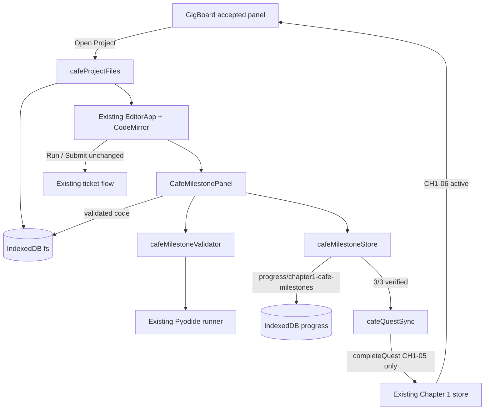

# Café Coding Milestones — Implementation

## 1. Summary

Stage B, Step 6 turns the Chapter 1 GigBoard project "Build a Café Order
Calculator" into three real Python milestones inside the existing Pixel OS
editor. Each milestone executes the student's code with the shared Pyodide
runner and checks actual Python behavior. Passing code is saved to the existing
IndexedDB filesystem, milestone progress is persisted in an isolated versioned
record, and 3/3 verified milestones complete CH1-05 exactly once so the story
advances to CH1-06. No second editor, Python runtime, database, payment, or XP
path was added.

## 2. Files created and modified

Created under `src/features/chapter1/cafeCoding/`:

- `cafeMilestones.ts` — milestone definitions, instructions, starter code, tests.
- `cafeMilestoneProgress.ts` — pure progress model, sequential completion,
  versioned save envelope, and untrusted-data validation.
- `cafeMilestoneValidator.ts` — Pyodide validation, structured feedback, lock.
- `cafeMilestoneStore.ts` — Zustand store, hydration, serialized writes,
  retryable quest-sync error state.
- `cafeQuestSync.ts` — pure access gate and idempotent CH1-05 sync adapter.
- `cafeProjectFiles.ts` — idempotent file creation and editor launch adapter.
- `CafeMilestonePanel.tsx` — milestone and test-feedback UI.
- `cafeCoding.css` — panel styling.

Focused tests: `cafeMilestones.test.ts`, `cafeMilestoneValidator.test.ts`,
`cafeMilestoneStore.test.ts`, `cafeProjectFiles.test.ts`,
`cafeQuestSync.test.ts`, and `src/features/editor/EditorApp.test.tsx`.

Modified: `EditorApp.tsx` (panel rendering), `GigBoardJobDetails.tsx`
(accepted-project progress and Open Project), `browser.css`,
`app/PixelOS.tsx` (startup hydration).

## 3. Milestone definitions

Milestones are a strict ordered array; progress is a prefix, so the stored
index always equals the number of completed milestones.

| # | ID | File | Checks |
|---|----|------|--------|
| 1 | `variables-print` | `cafe_milestone_1.py` | `coffee_price == 3`, `sandwich_price == 5`, prints `3` and `5` |
| 2 | `arithmetic-functions` | `cafe_milestone_2.py` | `calculate_total(2,1)=11`, `(0,2)=10`, `(3,0)=9`, `(1,1)=8` |
| 3 | `conditional-discounts` | `cafe_milestone_3.py` | `apply_discount` at `10→10`, `19→19`, `20→18`, `30→27`, `50→45` |

Starter files contain comments, instructions, and empty function signatures.
They never contain a complete solution.

## 4. Python verification architecture

For each test case the validator runs the student's code as the program and the
case's Python assertions as the runner's `check` payload. The runner executes
the check in the same namespace, so it can inspect variables and return values
directly.

Milestone 1 also inspects real stdout for the required numbers, accepting
harmless formatting such as `Coffee: $3.00`. A hardcoded print-only solution
still fails the variable assertions. Function milestones use independent calls
so fixed returns fail at least one case. Milestone 3 uses floating-point
tolerance and explicitly checks the `$20` boundary. Correctness never depends
on source-text matching.

Results distinguish `passed`, `failed`, `runtime-error`, and `busy`, and report
tests passed/executed/total plus per-test expected and actual values. A
program-phase error stops later cases; check-phase failures continue so the
student gets complete feedback. Timeouts, cancellation, empty code, and
truncated output have dedicated messages.

## 5. Pyodide runner integration

`validateCafeMilestone` accepts any `PythonRunner`; production passes the
existing `getPythonRunner()` singleton. Runs use the normal request shape: no
stdin, `echoPrompts: false`, a 5-second timeout, and a 20,000-character output
limit.

A module-level `validationActive` flag rejects overlapping requests with
`busy`. The panel adds a generation token: editing code, switching files,
unmounting, or completing a milestone invalidates older results so they cannot
be applied to newer code.

## 6. Editor integration

`EditorApp` renders `CafeMilestonePanel` above the CodeMirror editor. The panel
is hidden until the GigBoard application is hydrated and accepted. It shows
overall progress (`0/3` … `3/3`), milestone states, current instructions and
example output, a Run Tests button, structured results, and a retryable
quest-sync error.

Run Tests stays disabled unless the matching milestone file is open and CH1-05
is active. It never replaces the existing ticket Run or Submit tests. On
success it writes the exact validated code snapshot before committing progress,
then opens the next milestone file.

## 7. File saving and recovery

`ensureCafeMilestoneFiles` checks each canonical path before creating it.
Missing files receive starter code; existing files are never overwritten. If a
path contains a folder, the operation fails with a clear message. Opening a
project hydrates milestone progress, selects the current milestone (or
milestone 1 after 3/3), ensures files exist, uses the existing file session,
and launches the existing editor window. The normal unsaved-changes protection
still applies.

## 8. Milestone persistence

Storage lives in the existing `progress` store under the isolated key
`chapter1-cafe-milestones`. The versioned record contains
`currentMilestoneIndex` and an ordered `completedMilestones` array with ISO
timestamps.

Validation rejects wrong/missing versions, malformed progress, out-of-range
indexes, index/count mismatches, unknown/duplicated/out-of-order IDs, and
invalid timestamps. Invalid data resets safely to milestone 1 with a warning.
Load failures keep `hydrated: false` so actions cannot overwrite unread data.

Writes are serialized through a promise queue. New progress commits only after
the persistence layer confirms the write; a failure leaves prior progress
intact and allows retry by running the tests again.

## 9. Chapter 1 quest integration

Verification requires hydrated Chapter 1 state, `accepted` application status,
CH1-05 as the active quest, and hydrated milestone progress. After 3/3,
`syncCafeProjectQuest` calls only `completeQuest("CH1-05")`. It never touches
CH1-06, CH1-07, money, or XP. The Chapter 1 store saves before committing, and
repeated syncs are idempotent.

If milestone progress saved but CH1-05 failed, milestones stay verified and the
panel shows a retryable Chapter 1 update error. Retrying only re-runs quest
sync; it never reruns tests or resets files.

## 10. GigBoard integration

The accepted panel shows the current milestone, all milestone states, completed
count, percentage, and "Open Project in Editor". The button uses a small adapter,
keeping GigBoard independent of window-manager internals. At 3/3 the panel shows
"Project ready for delivery." No delivery or payment is implemented.

## 11. Automated tests and build results

- Focused café/editor tests: **59 passed** across 6 files.
- Full suite: **174 passed** across 16 files.
- Production build: **passed** (`npm run build`).
- ESLint on new café files, editor test, and GigBoard page: **passed**.

`EditorApp.tsx` and `PixelOS.tsx` retain pre-existing formatting/TypeScript
issues in unrelated code; no unrelated refactor was performed.

Coverage includes milestone ordering, correct/incorrect solutions for all three
milestones, the `$20` boundary, runtime errors, structured feedback, sequential
and duplicate progress, persistence/reload, malformed saves, save-failure
recovery, preserved project files, locked pre-acceptance state, CH1-05-only
completion, untouched CH1-06/payment, and quest-sync retry.

## 12. Manual browser testing

Recommended after `npm run dev`:

1. Accept Alex Morgan's proposal and confirm the café panel appears in Editor.
2. Run `print("3")` only and confirm milestone 1 fails.
3. Complete milestones 1–3 and confirm progress reaches 3/3.
4. Confirm Chapter 1 advances to CH1-06 with money/XP unchanged.
5. Reload and confirm files and milestone progress persist.
6. Open the project from GigBoard and confirm the current milestone opens.
7. Confirm normal ticket Run and Submit still work.

Manual browser interaction was not executed in this environment; behavior is
covered by focused jsdom tests and the shared runner contract.

## 13. Known limitations

- Validation needs the real Pyodide CDN load; tests use a scripted runner.
- Milestone 1 output checking requires numeric values in stdout.
- Milestones are single-file; imports between milestone files are not provided.
- Quest sync assumes the current singleton Chapter 1 and GigBoard stores.
- Pre-existing issues in `PixelOS.tsx` and `EditorApp.tsx` remain untouched.

## 14. Next step

Project delivery and client approval: a delivery action, Alex Morgan's final
response, CH1-06 completion, and the existing $50 payment path. None of that is triggered here.
