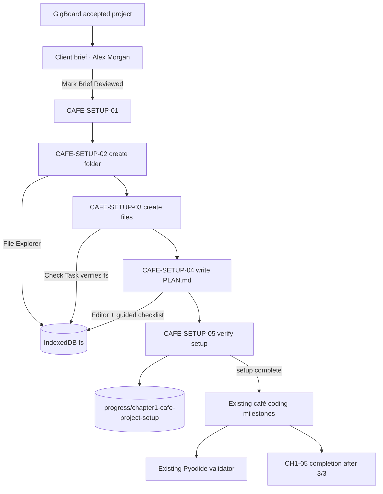

# Café Project Setup — Implementation

## 1. Summary

Stage B, Step 7 adds Phase A of the Chapter 1 café mission: a realistic project
setup workflow inside CH1-05. After Alex Morgan hires the player, the mission no
longer opens pre-created milestone files immediately. The player reads a client
brief, creates a project folder and four files by hand in File Explorer, writes
a development plan in the existing Editor, and verifies the setup before the
three existing Python milestones unlock.

The setup phase stores its own versioned progress record, never creates files
for the player, never awards XP or money, and never completes CH1-05. Existing
milestone saves continue to work without a destructive migration.

## 2. Files created and modified

Created under `src/features/chapter1/cafeSetup/`:

- `cafeSetupTasks.ts` — ordered setup definitions, canonical workspace path,
  required filenames, planning topics.
- `cafeClientBrief.ts` — Alex Morgan's requirement list.
- `cafeSetupProgress.ts` — pure prefix progress model, versioned save envelope,
  untrusted-data validation.
- `cafeSetupStore.ts` — Zustand store, IndexedDB hydration, serialized writes,
  retryable save errors.
- `cafeSetupChecks.ts` — filesystem verification for folder, files, and plan.
- `cafeSetupActions.ts` — open-app adapters, task checking, setup-aware project
  launch.
- `cafeSetupCompatibility.ts` — new-session vs existing-save decision.
- `CafeProjectGuidancePanel.tsx` — contextual guidance panel.
- `cafeSetup.css` — panel styling.
- Focused tests: `cafeSetupProgress.test.ts`, `cafeSetupChecks.test.ts`,
  `cafeSetupStore.test.ts`, `cafeSetupCompatibility.test.ts`,
  `CafeProjectGuidancePanel.test.tsx`.

Modified:

- `src/features/browser/pages/GigBoardJobDetails.tsx` — client brief, guidance
  panel, setup-aware project launch and button label.
- `src/features/browser/browser.css` — client brief styling.
- `src/features/chapter1/cafeCoding/CafeMilestonePanel.tsx` — setup gating for
  Run Tests and milestone file opening.
- `src/features/chapter1/cafeCoding/cafeCoding.css` — setup-required notice.
- `src/features/progress/ProgressApp.tsx` — compact guidance panel.
- `src/app/PixelOS.tsx` — setup hydration at startup.

## 3. Setup workflow

Tasks are strictly ordered and progress is a prefix of the canonical array:

| # | ID | Task | Verification |
|---|----|------|--------------|
| 1 | `read-brief` | Read Client Brief | Player clicks **Mark Brief Reviewed** |
| 2 | `create-folder` | Create Project Folder | `cafe-calculator` exists and is a folder |
| 3 | `create-files` | Create Project Files | Four exact filenames exist as files |
| 4 | `write-plan` | Write Development Plan | Six-topic checklist + meaningful `PLAN.md` text |
| 5 | `verify-setup` | Verify Project Setup | Folder, files, and plan content re-checked |

Skipping, repeating, or completing a later task is rejected by the pure model
and the store. The brief acknowledgment only covers reading; it never verifies
file creation or coding.

## 4. Filesystem integration

The canonical workspace is `/Projects/Python/cafe-calculator`, consistent with
the existing Explorer sidebar. Required files are `PLAN.md`, `calculator.py`,
`main.py`, and `README.md`.

Verification uses the existing `getEntry()` filesystem API only:

- Missing folder and missing files produce specific messages.
- A required file that is a folder is rejected.
- Incorrect names (for example `plan.md`) remain missing.
- Existing entries are never overwritten, because setup never calls
  `createEntry` or `writeFile`.

The player opens File Explorer through the existing window manager. For the
planning task, **Open PLAN.md in Editor** opens the existing Editor file session
and never creates the file.

## 5. Progress persistence

Setup progress is isolated in the existing `progress` object store:

- Store: `progress`
- Key: `chapter1-cafe-project-setup`
- Version: `1`
- Fields: `currentTaskIndex`, ordered `completedTasks` with ISO timestamps.

Validation rejects wrong versions, malformed objects, out-of-range indexes,
index/count mismatches, unknown or out-of-order task IDs, and invalid
timestamps. Invalid data resets safely to Task 1 and displays a warning.
Unreadable storage keeps `hydrated: false` so a player action cannot overwrite a
record that could not be loaded.

Writes are serialized through an internal promise queue. Progress commits only
after a successful save. A failed save leaves previous progress intact and
returns a retryable error; checking the task again retries.

## 6. Existing-save compatibility

`evaluateCafeSetupRequirement` distinguishes sessions:

- **New session:** no completed setup, zero milestone progress, and no existing
  milestone file. Setup is required, so Run Tests stays locked.
- **Completed setup:** setup record is 5/5. Coding milestones are unlocked.
- **Existing development save:** milestone progress is already above 0/3, or a
  legacy `cafe_milestone_1.py` file exists. Setup is not forced, all existing
  files and milestone progress are preserved, and the old workflow continues.

`CH1-05` is never completed by setup, and setup never writes Chapter 1, money,
XP, GigBoard application, or ticket records. A completed CH1-05 remains
completed. New setup work is additive and does not rewrite milestone files.

## 7. Automated tests and build results

Focused setup tests: **27 passed / 5 files**.

Full suite: **216 passed / 23 files**.

Production build: **passed** (`npm run build`, exit 0).

ESLint on all new setup files, the milestone panel, and the GigBoard page:
**passed**.

Coverage includes sequential and duplicate task handling, brief acknowledgment,
folder existence, exact filenames, wrong names, missing files, plan checklist
and content, persistence and reload, corrupted records, save failure and retry,
legacy milestone compatibility, no automatic file creation, no CH1-05
completion, and unchanged money/XP.

## 8. Manual browser testing steps

1. Run `npm run dev` and open GigBoard → **Build a Café Order Calculator**.
2. With an accepted application, read the client brief and click **Mark Brief
   Reviewed**.
3. Open File Explorer from the guidance panel. Navigate to `/Projects/Python`,
   create `cafe-calculator`, then create the four files.
4. Click **Check Task** after each stage and confirm specific missing-file
   errors appear before the files exist.
5. Open `PLAN.md`, write a short plan, tick all six topics, and click **Check
   Task**.
6. Verify the final setup task and confirm "Project setup complete".
7. Confirm the Editor now allows the existing café milestones to run.
8. Reload and confirm setup progress, files, and plans persist.
9. Confirm no XP, money, CH1-05 completion, or automatic file creation occurred.

## 9. Known limitations

- `PLAN.md` validation is intentionally lightweight: the six topics come from a
  player checklist plus a minimum meaningful-text check. It does not claim to
  understand the plan semantically.
- A legacy save with 0/3 milestones and no milestone file is treated as a new
  session and must complete setup once. No progress is reset.
- Setup files are verified in the shared virtual filesystem; there is no real
  operating-system filesystem access.
- `ProgressApp.tsx` and `PixelOS.tsx` retain pre-existing formatting
  violations; only the minimal integration lines were changed.
- Manual browser interaction was not executed here; behaviour is covered by
  focused jsdom tests and filesystem checks.

## 10. Next recommended step

Implement Phase B: connect the four setup files to the existing coding
milestones, then add project delivery to CH1-06 and Alex Morgan's final
approval. Delivery and payment remain intentionally unimplemented.
