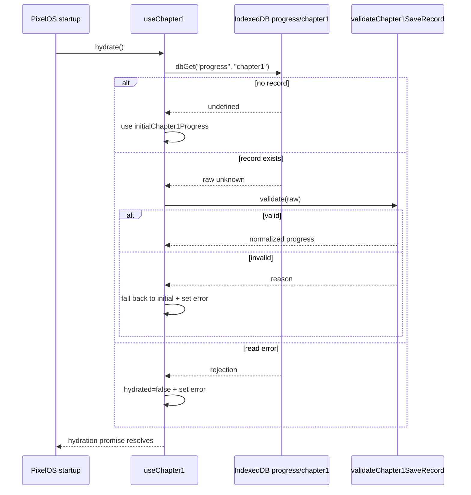

# Chapter 1 Persistent Quest Progress — Implementation

**Task:** Stage B, Step 2 — Persistent Chapter 1 state
**Branch:** `pixelos-dev`
**Status:** Complete for the scoped persistence task

---

## 1. Executive summary

Added persistent Chapter 1 quest progress using the existing Zustand and IndexedDB architecture. Progress now loads automatically when Pixel OS starts, is validated before use, and is written only after a valid quest transition succeeds. The `$50` payment remains one-time across reloads.

Implemented:

- An isolated Chapter 1 Zustand store (`chapter1Store.ts`).
- A save envelope and validation layer (`chapter1Validation.ts`).
- Startup hydration in `src/app/PixelOS.tsx`.
- 19 focused Vitest tests for hydration, validation, persistence, rapid updates, concurrency, errors, and payment safety.
- This document.

Not implemented: quest UI, GigBoard, client messages, Python milestone triggers, Godot events, global wallet integration, and multi-tab coordination.

---

## 2. Architecture before implementation

- Chapter 1 already had pure quest definitions and transitions in `chapter1Quests.ts` and `chapter1Progress.ts`.
- Existing ticket/XP persistence uses:
  - Zustand store: `src/features/progress/progressStore.ts`.
  - IndexedDB helpers: `src/services/persistence/db.ts`.
  - Save wrapper: `src/services/persistence/saveStatus.ts`.
- IndexedDB database: `codequest-pixel-os`, version `1`, with object stores `progress`, `drafts`, `prefs`, `chat`, and `fs`.
- Ticket progress is stored in the `progress` store under key `state`.
- Pixel OS restores saved data in one startup effect using `dbGet` / `dbGetAll`.
- `trackedSave` returns a boolean and updates global save status instead of throwing.

No IndexedDB version change or new object store was needed. Chapter 1 uses the existing `progress` object store under a new key.

---

## 3. Files created and modified

| File | Action | Purpose |
|---|---|---|
| `src/features/chapter1/chapter1Validation.ts` | Created | Save envelope plus validation of untrusted persisted data. |
| `src/features/chapter1/chapter1Store.ts` | Created | Zustand store, hydration deduplication, serialized saves, error state, and testable persistence injection. |
| `src/features/chapter1/chapter1Store.test.ts` | Created | 19 focused tests for hydration, persistence, validation, concurrency, and payment protection. |
| `src/app/PixelOS.tsx` | Modified | Added Chapter 1 hydration to the existing startup restore flow. |
| `docs/CHAPTER1_PERSISTENCE_IMPLEMENTATION.md` | Created | This documentation. |

Unchanged: `chapter1Quests.ts`, `chapter1Progress.ts`, ticket/XP stores, Python runner, editor, routing, and Godot integration.

---

## 4. State management design

`Chapter1Store` exposes:

| Property / action | Meaning |
|---|---|
| `progress` | Validated `Chapter1Progress`; initially `initialChapter1Progress`. |
| `hydrated` | `true` once a load attempt has established usable state. Remains `false` if storage could not be read. |
| `loading` | `true` while a hydration read is in progress. |
| `error` | Last load/save/recovery error message, or `null`. |
| `hydrate()` | Loads and validates IndexedDB data. Safe to call repeatedly. |
| `completeQuest(questId)` | Attempts one pure transition, saves it, then commits state. Resolves `true` only when saved. |

The store never edits progress fields directly. Every successful transition comes from `completeChapter1Quest`.

`createChapter1Store(persistence)` is exported for tests. Production uses the shared `useChapter1` singleton with the real `dbGet` / `trackedSave` functions.

Storage constants:

```ts
CHAPTER1_STORAGE_STORE = "progress"
CHAPTER1_STORAGE_KEY = "chapter1"
```

This leaves the ticket/XP record at `progress` / `state` untouched.

---

## 5. Save and load lifecycle

### Hydration

1. Pixel OS mounts and its existing startup effect runs once.
2. The effect includes `useChapter1.getState().hydrate()` in its `Promise.all`.
3. The store reads `dbGet("progress", "chapter1")`.
4. Missing record → use `initialChapter1Progress`, mark hydrated.
5. Invalid record → use initial state, mark hydrated, report recovery through `error`; the malformed record is not deleted.
6. Read failure → leave `hydrated = false`, report error, and allow a later retry.
7. Concurrent `hydrate()` calls share one in-flight promise.
8. After a successful hydration, further calls return immediately and preserve in-memory progress on component remount.



### Saving

Only `completeQuest` writes Chapter 1 data:

1. Wait for hydration.
2. If not hydrated, return `false` without writing.
3. Read the latest progress from the store.
4. Run `completeChapter1Quest`; a rejected transition returns `false` without writing.
5. Build a versioned save record with all fields.
6. Call `trackedSave("progress", "chapter1", record)`.
7. On success, commit the new progress and clear `error`.
8. On failure, keep prior state, set `error`, and allow the same completion to be retried.

The record is absolute, not incremental, so an older save cannot partially merge with a newer one.

---

## 6. Validation logic

`validateChapter1SaveRecord(raw)` rejects anything that is not a fully consistent Chapter 1 save:

- Record must be a non-array object.
- `version` must equal `1`.
- `progress` must be an object.
- `currentQuestIndex` must be an integer from `0` through the quest count.
- `completedQuestIds` must be an array.
- Its length must equal `currentQuestIndex`.
- Every ID must be a valid literal `Chapter1QuestId`.
- Duplicate IDs are rejected.
- Completed IDs must match the exact canonical prefix of `CHAPTER1_QUESTS`.
- `money` must be a finite, non-negative number.
- `paymentClaimed` must be a boolean.
- Money must equal the sum of rewards for the completed prefix: `$0` before CH1-07 and `$50` after it.
- `paymentClaimed` must be `true` exactly when a reward has been earned.
- No payment is accepted before CH1-07.

A validation failure does not crash and does not delete the record. The store falls back to initial progress and exposes a descriptive error, so recovery is observable. A later successful save replaces the malformed record.

---

## 7. Concurrency and error handling

### Overlapping saves

A per-store promise queue serializes `completeQuest` tasks in call order. Each queued task reads state only when it starts, so it always sees the latest committed progress. If save 1 is still pending, save 2 waits. An older write therefore cannot finish after a newer write and overwrite it.

### Rapid completions

Two calls such as CH1-01 followed immediately by CH1-02 are queued. The first validates, saves, and commits CH1-01; the second then sees CH1-02 as active, saves, and commits. Both records are preserved.

### Repeated hydration

`hydrationPromise` deduplicates in-flight reads. Once `hydrated` is true, `hydrate()` is a no-op, so Pixel OS remounts do not reset valid in-memory progress.

### Load failure

`hydrated` stays `false`. `completeQuest` will not write, preventing initial state from overwriting an unread save. A later `hydrate()` retries the read.

### Save failure

`trackedSave` returns `false` or the store catches a thrown error. The in-memory state remains at its previous value, `error` is set, and the same quest can be retried because the transition was never committed.

### Guarantees and limitations

Guaranteed in one tab:

- Rejected transitions produce no write.
- Saves are ordered.
- State commits only after a successful write.
- A failed save is observable and retryable.

Limits:

- Browser shutdown before an IndexedDB write commits can lose the newest action. The previous saved record remains valid.
- There is no `beforeunload` flush.
- Multiple tabs are not coordinated; last writer wins for the whole record. Absolute records prevent additive double payments, but a stale tab could regress other progress.
- A malformed record remains in IndexedDB until the next successful save replaces it, by design so recovery is not silent.

---

## 8. Payment safety

- CH1-07 is the only quest with `moneyReward > 0`.
- The pure transition can complete CH1-07 only once, in sequence.
- A repeated CH1-07 call is rejected before any save.
- The persisted record includes both `money` and `paymentClaimed`.
- Validation requires `money === 50` and `paymentClaimed === true` after CH1-07, and `$0` / `false` before it.
- State is committed only after the payment record is saved, so memory cannot claim a payment that storage rejected.
- Reloading hydrates the saved `$50` and prevents another grant.
- Because saves store the complete record rather than adding money, two identical saves cannot accumulate `$100`.

---

## 9. Code walkthrough

`createChapter1SaveRecord(progress)` copies all four progress fields into a versioned `{ version, progress }` envelope and clones `completedQuestIds`.

`validateChapter1SaveRecord(raw)` is a pure validator returning either `{ ok: true, progress }` or `{ ok: false, reason }`. It never throws for malformed values.

`createChapter1Store(persistence)` closes over one hydration promise and one save queue. Injecting `load` / `save` lets tests simulate delays and failures without touching real IndexedDB.

`hydrate()` short-circuits after success, deduplicates concurrent calls, and separates invalid-data recovery from storage-read failure.

`completeQuest(questId)` enqueues a task, awaits hydration, delegates the transition to `completeChapter1Quest`, saves only a valid transition, and commits only after the save succeeds.

---

## 10. Tests and results

Focused command:

```bash
npx vitest run src/features/chapter1/chapter1Store.test.ts
```

Result: **19 tests passed**.

| Test | Expected | Actual |
|---|---|---|
| Initial state | Initial progress, not hydrated | Pass |
| No save | Initial progress, hydrated | Pass |
| Valid save | Saved progress restored | Pass |
| Complete CH1-01 | Saves full record and commits | Pass |
| Repeat completed quest | No second write | Pass |
| Skip ahead | No write, state unchanged | Pass |
| Reload after CH1-07 | `$50` and claimed flag restored | Pass |
| Repeat CH1-07 | No additional money or write | Pass |
| Invalid quest ID | Rejected, no write | Pass |
| Malformed save | Rejected, fallback, error reported | Pass |
| Invalid quest order | Rejected, fallback | Pass |
| Inconsistent payment/money | Rejected, fallback | Pass |
| Rapid CH1-01 + CH1-02 | Both saved in order | Pass |
| Overlapping saves | Second waits; older write cannot win | Pass |
| Repeated hydration | One read, progress preserved | Pass |
| Load failure | No write, error, later retry works | Pass |
| Save failure | Prior state kept, error, retry works | Pass |
| Storage key isolation | Uses `progress/chapter1`, not `state` | Pass |
| Startup safety | Hydration does not reject Pixel OS startup | Pass |

Full verification:

| Command | Result |
|---|---|
| `npm test` | **6 test files, 54 tests passed** |
| `npm run build` | **Success** |
| `npx tsc --noEmit` | 4 pre-existing errors only; no new errors |
| `npx eslint src/features/chapter1` | Pass |

Pre-existing TypeScript errors remain in `src/app/PixelOS.tsx` (two `never` property errors), `src/features/editor/EditorApp.tsx` (optional message), and `src/features/terminal/TerminalApp.tsx` (`string | undefined`). They are unrelated and were not modified.

Build warnings are non-fatal: the existing `vite-tsconfig-paths` notice, the `db.ts` dynamic/static import notice, the over-500 kB chunk warning, and the Nitro `inlineDynamicImports` notice.

---

## 11. Manual verification

There is no quest UI yet. Use the browser console in development:

1. Run `npm run dev`.
2. Open the game route and open Pixel OS normally.
3. In DevTools console:
   ```js
   const { useChapter1 } = await import("/src/features/chapter1/chapter1Store.ts");
   useChapter1.getState();
   ```
   Confirm `hydrated: true` and `progress.currentQuestIndex: 0` on a fresh save.
4. Complete one quest:
   ```js
   await useChapter1.getState().completeQuest("CH1-01");
   ```
5. Reload the page, then inspect the store again. Confirm the index is `1` and `completedQuestIds` contains `CH1-01`.
6. In DevTools → Application → IndexedDB → `codequest-pixel-os` → `progress`, confirm:
   - `chapter1` contains the Chapter 1 record.
   - `state` (ticket/XP progress) still exists and was not changed by Chapter 1 actions.
7. To test recovery, edit the `chapter1` record in DevTools so its quest order is invalid, reload, and confirm the store falls back to index `0` with a non-null `error`.
8. To test rejection, call `completeQuest("CH1-03")` while CH1-01 is active and confirm it resolves `false` and does not create a new record.

These are temporary manual checks only; no debug controls are added to the UI.

---

## 12. Known limitations

- No visible Chapter 1 quest tracker or objective UI.
- No GigBoard, client messaging, or submission flow.
- No Python milestone integration.
- No Godot event triggers.
- No global wallet integration; Chapter 1 `money` remains local.
- No cross-tab save coordination.
- No flush guarantee if the browser closes mid-write.
- Malformed saves remain on disk until replaced by the next successful save.
- Hydration is intentionally one-time per session after success; external tab changes are not re-read.
- Only save version `1` is supported.

---

## 13. Recommended next step

Add a read-only Chapter 1 objective tracker to the existing Progress app:

- Create a small component that reads `useChapter1((s) => s.progress)` and calls `getCurrentChapter1Quest`.
- Show chapter title, current quest ID/title/objective, completed count out of eight, and Chapter 1 `$50` status.
- Show chapter-complete state when the selector returns `null`.
- Show `useChapter1.error` as a non-blocking warning when recovery or storage failure occurred.
- Do not add completion buttons or gameplay triggers yet.
- Add a focused React Testing Library test for initial, in-progress, and complete states.

This provides visible value while keeping all progression triggers under future gameplay control.

---

## 14. Final summary

Created the Chapter 1 validation and store modules plus 19 tests, and connected automatic hydration to Pixel OS startup. No existing store keys, database version, ticket logic, XP logic, editor behavior, or Godot bridge behavior changed.

- Tests: **54/54 passed across 6 files** (19 new).
- Build: **successful**.
- Type-check: only the 4 known pre-existing errors.
- Lint: Chapter 1 clean.
- Changes remain local and uncommitted on `pixelos-dev`.

Remaining work: visible tracker, real gameplay triggers, GigBoard/client/milestone flows, Godot event integration, and eventual wallet/economy mapping.
