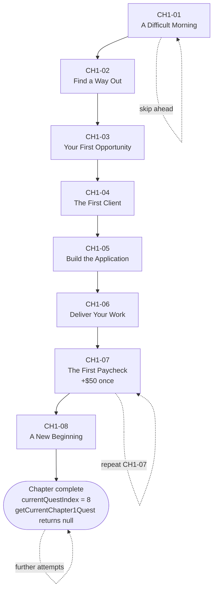

# Chapter 1 Quest Manager — Implementation Documentation

**Task:** CodeQuest Chapter 1 Quest Manager (Stage B, Step 1)
**Chapter:** The First Paycheck
**Branch:** `pixelos-dev`
**Status:** Complete for the scoped foundation stage
**Date:** 2026-11-06

---

## 1. Executive Summary

### Intended outcome

This task was intended to establish the foundational, type-safe quest progression system for Chapter 1 of CodeQuest. The system needed to define the eight ordered Chapter 1 quests, model progress immutably, prevent skipping and duplicate completion, grant the one-time $50 in-game payment exactly once, expose the active quest, and be covered by automated tests and documentation.

The work was intentionally limited to progression logic. No GigBoard UI, client messaging, Python lesson integration, wallet UI, NPC dialogue, persistence integration, or Godot changes were in scope.

### What was implemented

- A canonical Chapter 1 quest definition module with eight ordered quests.
- TypeScript literal types for all quest IDs, derived from the quest definitions.
- A serializable `Chapter1Progress` model and initial state.
- A pure `completeChapter1Quest(progress, questId)` state transition function.
- A pure `getCurrentChapter1Quest(progress)` selector.
- Guards against skipping, repeating, completing after the chapter ends, invalid IDs, and invalid stored indexes.
- One-time $50 payment protection using both sequential completion and a `paymentClaimed` flag.
- 16 new Vitest tests covering the required scenarios.
- This implementation document.

### What was intentionally not implemented

- GigBoard browser or job application UI.
- Client messaging.
- Python lesson/milestone integration.
- Wallet UI or global economy integration.
- New NPC dialogue or Godot changes.
- New `postMessage` event types or automatic quest triggers.
- React hooks, Zustand stores, or UI components for Chapter 1.
- IndexedDB save/load for Chapter 1 progress.
- Any modification to the existing ticket, XP, Python runner, or windows systems.

### Completion status

The scoped task was completed successfully:

- All 35 tests pass (19 pre-existing + 16 new).
- `npm run build` succeeds.
- No new TypeScript errors were introduced. The four TypeScript errors reported by `npx tsc --noEmit` are pre-existing and were verified before making changes.
- The new files pass ESLint.
- Changes remain local, uncommitted working-tree changes on `pixelos-dev`.

---

## 2. Existing Architecture Before Changes

This section separates **observed repository facts** from **decisions/assumptions made for this task**.

### Observed facts

#### React application structure

- The project is a TanStack Start / TanStack Router application using React 19, TypeScript, Vite, and Vitest.
- Routes live in `src/routes/`.
- The game route is `src/routes/game.tsx`.
- Feature modules live in `src/features/` (tickets, progress, editor, chat, explorer, terminal, settings, notifications).
- Shared application shell code lives in `src/app/` and `src/core/`.
- Pixel OS applications are registered in `src/core/applications/registry.ts` and rendered by `src/app/PixelOS.tsx`.

#### Existing progress and ticket logic

- `src/features/tickets/data/tickets.ts` defines five Python tickets (`CQ-001` through `CQ-005`) and their XP values.
- `src/features/progress/progressLogic.ts` contains pure ticket progression functions:
  - `isUnlocked`
  - `ticketStatus`
  - `totalXp`
  - `levelForXp`
  - `applyVerifiedCompletion`
  - `nextTicketAfter`
  - `achievements`
- XP is derived from completion records and ticket definitions, not stored as a separate counter.
- `applyVerifiedCompletion` awards XP only once per ticket, only when unlocked, and only after a verified Pyodide test run passes.
- `src/features/progress/progressStore.ts` is a Zustand store that wraps the pure logic, persists progress, sends notifications, and updates chat.
- No existing quest, chapter, quest-manager, GigBoard, or Chapter 1 progression code was found in `src/`.

#### Existing persistence

- `src/services/persistence/db.ts` provides versioned IndexedDB storage.
- Database name: `codequest-pixel-os`, version `1`.
- Object stores: `progress`, `drafts`, `prefs`, `chat`, `fs`.
- `src/services/persistence/saveStatus.ts` provides `trackedSave` and `debouncedSave`, with save-state tracking and error reporting.
- `src/app/PixelOS.tsx` restores window geometry, settings, ticket progress, chat, and drafts on startup.

#### Existing Godot–React bridge

- `src/routes/game.tsx` embeds `/godot/index.html` in an iframe with id `codequest-godot`.
- It listens for `window` `message` events and validates:
  - `event.origin === window.location.origin`
  - `event.source === the Godot iframe contentWindow`
- It handles `codequest:open-os` by showing the Pixel OS.
- The "Exit Computer · Return to Game" button hides Pixel OS and returns to the still-mounted Godot iframe, preserving the game session.
- No Chapter 1 events were previously defined.

#### Existing tests and test conventions

- `vitest.config.ts` uses `jsdom`, global test APIs, and `src/test/setup.ts`.
- Test files follow `*.test.ts` / `*.test.tsx`.
- Existing test files:
  - `src/test/app-routing.test.tsx`
  - `src/core/windows/windowReducer.test.ts`
  - `src/features/progress/progressLogic.test.ts`
  - `src/services/runner/testing.test.ts`
- Baseline result before changes: **4 test files, 19 tests passing**.
- `progressLogic.test.ts` demonstrates the preferred style: pure functions tested directly with Vitest.

#### TypeScript and scripts

- `tsconfig.json` enables `strict`, `noUncheckedIndexedAccess`, `exactOptionalPropertyTypes`, and `noImplicitReturns`.
- Relevant package scripts:
  - `npm test` → `vitest run`
  - `npm run build` → `vite build`
  - `npm run lint` → `eslint .`
- No dedicated type-check script exists, so `npx tsc --noEmit` was used.

### Decisions and assumptions

- Because no existing quest manager existed, a new isolated feature folder `src/features/chapter1/` was created. This follows the repository's existing `src/features/<domain>/` convention.
- The new module was kept independent of the existing ticket/XP system because Chapter 1 progression is a separate domain and the task explicitly forbids modifying ticket validation or XP reward logic.
- The existing persistence layer was intentionally not connected yet. The task asks for a foundation "ready for later integration," not persistence integration.
- The existing application registry and window manager were intentionally not touched, because no Chapter 1 UI was in scope.
- The `docs/` folder did not exist and was created for this deliverable.

---

## 3. Files Created and Modified

| File | Action | Purpose |
|---|---|---|
| `src/features/chapter1/chapter1Quests.ts` | Created | Canonical Chapter 1 quest definitions, literal ID types, lookup helpers, and runtime ID guard. |
| `src/features/chapter1/chapter1Progress.ts` | Created | Progress model, initial state, active-quest selector, and immutable quest completion transition. |
| `src/features/chapter1/chapter1Progress.test.ts` | Created | Vitest coverage for quest order, progression, duplicate prevention, payment protection, chapter completion, and invalid input. |
| `docs/CHAPTER1_QUEST_MANAGER_IMPLEMENTATION.md` | Created | This implementation and design document. |

No existing source files were modified. The existing ticket, XP, Python runner, persistence, routing, Pixel OS, and Godot integration files were left untouched.

---

## 4. Implementation Details

### 4.1 `src/features/chapter1/chapter1Quests.ts`

#### `Chapter1QuestDefinition`

```ts
export interface Chapter1QuestDefinition {
  readonly id: string;
  readonly title: string;
  readonly objective: string;
  readonly moneyReward: number;
}
```

Describes the shape of a quest definition. The interface uses `string` for `id` only at the definition boundary; the exported quest ID type is narrowed to literal values after the canonical array is declared.

#### `CHAPTER1_PAYMENT_REWARD`

```ts
export const CHAPTER1_PAYMENT_REWARD = 50;
```

The single source of truth for the Chapter 1 payment amount. The CH1-07 quest definition references this constant instead of duplicating `50` elsewhere.

#### `CHAPTER1_QUESTS`

```ts
export const CHAPTER1_QUESTS = [
  { id: "CH1-01", title: "A Difficult Morning", /* ... */ moneyReward: 0 },
  // ...
  { id: "CH1-07", title: "The First Paycheck", /* ... */ moneyReward: CHAPTER1_PAYMENT_REWARD },
  // ...
] as const satisfies readonly Chapter1QuestDefinition[];
```

This is the ordered, immutable, single source of truth for the entire chapter. The `as const` preserves literal IDs and the `satisfies` clause validates the shape without widening the literal types.

Quest order:

| ID | Title | Objective | Money |
|---|---|---|---|
| `CH1-01` | A Difficult Morning | Listen to your father's warning | $0 |
| `CH1-02` | Find a Way Out | Go to your bedroom and open the computer | $0 |
| `CH1-03` | Your First Opportunity | Find a freelance Python job on GigBoard | $0 |
| `CH1-04` | The First Client | Apply for the café calculator project | $0 |
| `CH1-05` | Build the Application | Complete all three Python milestones | $0 |
| `CH1-06` | Deliver Your Work | Submit the completed project to the client | $0 |
| `CH1-07` | The First Paycheck | Receive the $50 payment | $50 |
| `CH1-08` | A New Beginning | Return to your father and share the news | $0 |

#### `Chapter1Quest` and `Chapter1QuestId`

```ts
export type Chapter1Quest = (typeof CHAPTER1_QUESTS)[number];
export type Chapter1QuestId = Chapter1Quest["id"];
```

`Chapter1QuestId` is the literal union:

```ts
"CH1-01" | "CH1-02" | "CH1-03" | "CH1-04" | "CH1-05" | "CH1-06" | "CH1-07" | "CH1-08"
```

Because the union is derived from `CHAPTER1_QUESTS`, adding or removing a quest automatically updates the type. There is no second hard-coded quest list.

#### `CHAPTER1_QUEST_IDS`

```ts
export const CHAPTER1_QUEST_IDS: readonly Chapter1QuestId[] = CHAPTER1_QUESTS.map(
  (quest) => quest.id,
);
```

A derived read-only list of IDs, useful for iteration and validation. It cannot drift from the canonical definitions.

#### `CHAPTER1_QUESTS_BY_ID`

```ts
export const CHAPTER1_QUESTS_BY_ID = Object.fromEntries(
  CHAPTER1_QUESTS.map((quest) => [quest.id, quest]),
) as Record<Chapter1QuestId, Chapter1Quest>;
```

A lookup table keyed by quest ID. The cast is required because `Object.fromEntries` cannot prove the completeness of a literal union key set.

#### `isChapter1QuestId`

```ts
export function isChapter1QuestId(value: unknown): value is Chapter1QuestId {
  return typeof value === "string" && CHAPTER1_QUEST_ID_SET.has(value);
}
```

A runtime type guard for IDs that may come from persistence, browser events, or other untyped sources. It returns `false` for non-strings and unknown strings.

### 4.2 `src/features/chapter1/chapter1Progress.ts`

#### `Chapter1Progress`

```ts
export interface Chapter1Progress {
  currentQuestIndex: number;
  completedQuestIds: Chapter1QuestId[];
  money: number;
  paymentClaimed: boolean;
}
```

- `currentQuestIndex` is the index into `CHAPTER1_QUESTS` of the only quest that can currently be completed.
- An index equal to `CHAPTER1_QUESTS.length` means the chapter is complete.
- `completedQuestIds` records completion order.
- `money` is Chapter 1-local in-game earnings, not a global wallet balance.
- `paymentClaimed` independently guards the one-time payment.

This matches the suggested model exactly; no deviation was needed.

#### `initialChapter1Progress`

```ts
export const initialChapter1Progress: Chapter1Progress = {
  currentQuestIndex: 0,
  completedQuestIds: [],
  money: 0,
  paymentClaimed: false,
};
```

The chapter starts at CH1-01 with no completions, no money, and no claimed payment. The progression functions never mutate this object.

#### `getCurrentChapter1Quest(progress)`

```ts
export function getCurrentChapter1Quest(progress: Chapter1Progress): Chapter1Quest | null {
  const index = progress.currentQuestIndex;
  if (!Number.isInteger(index) || index < 0 || index >= CHAPTER1_QUESTS.length) return null;
  return CHAPTER1_QUESTS[index] ?? null;
}
```

- **Input:** a `Chapter1Progress` object.
- **Output:** the active `Chapter1Quest`, or `null` when the chapter is complete or the stored index is invalid.
- **Logic:** validates that the index is a non-negative integer within the canonical quest array, then returns the indexed quest.
- **Edge cases:** negative indexes, non-integers, `NaN`, and indexes at or beyond the array length all return `null`.

#### `completeChapter1Quest(progress, questId)`

```ts
export function completeChapter1Quest(
  progress: Chapter1Progress,
  questId: Chapter1QuestId,
): Chapter1Progress {
  // Defensive runtime check: quest IDs may originate from persisted or event data.
  if (!isChapter1QuestId(questId)) return progress;

  const currentQuest = getCurrentChapter1Quest(progress);
  if (!currentQuest) return progress;
  if (currentQuest.id !== questId) return progress;
  if (progress.completedQuestIds.includes(questId)) return progress;

  const reward = progress.paymentClaimed ? 0 : currentQuest.moneyReward;

  return {
    currentQuestIndex: progress.currentQuestIndex + 1,
    completedQuestIds: [...progress.completedQuestIds, questId],
    money: progress.money + reward,
    paymentClaimed: progress.paymentClaimed || reward > 0,
  };
}
```

- **Inputs:** current progress and the quest ID being completed.
- **Output:** a new `Chapter1Progress` on a valid transition; the original object unchanged on every invalid/no-op transition.
- **Validation rules, in order:**
  1. The ID must be a valid Chapter 1 quest ID.
  2. There must be an active quest (chapter not complete, index valid).
  3. The submitted ID must equal the active quest ID.
  4. The active quest must not already appear in `completedQuestIds`.
- **State changes on success:**
  - `currentQuestIndex` increments by one.
  - The quest ID is appended to a newly allocated `completedQuestIds` array.
  - `money` increases by the active quest's `moneyReward`, unless the payment was already claimed.
  - `paymentClaimed` becomes `true` when a positive reward is granted.
- **No-op behavior:** repeated quests, skipped quests, invalid IDs, invalid indexes, and all attempts after chapter completion return the exact same object reference. This makes idempotency easy to assert in tests.
- **Immutability:** the original object and its array are never mutated.

The module has no React, Zustand, browser, storage, or UI imports.

---

## 5. Quest Progression Logic

The chapter is a strictly linear sequence. `currentQuestIndex` identifies the only completable quest. A valid completion advances the index by exactly one.



The dotted self-loops represent rejected transitions: the state does not change.

### Why quests cannot be skipped

Skipping is prevented by the active-quest comparison:

```ts
if (currentQuest.id !== questId) return progress;
```

If the player is on CH1-03 and submits CH1-08, the active quest is CH1-03, so the transition is rejected and the original state is returned. There is no path that increments `currentQuestIndex` by more than one.

### Duplicate completion prevention

A completed quest can never be the active quest again under normal progression, because the index has already advanced. As a defensive layer, the function also checks:

```ts
if (progress.completedQuestIds.includes(questId)) return progress;
```

This protects against malformed or externally constructed progress objects.

### Chapter-complete state

After CH1-08 is completed:

- `currentQuestIndex` becomes `8`, which equals `CHAPTER1_QUESTS.length`.
- `getCurrentChapter1Quest` returns `null` because the index is out of range.
- `completeChapter1Quest` returns the existing state unchanged for every subsequent call, because there is no active quest.

This is a valid terminal state: the chapter is complete, all eight IDs are recorded, and no further quest can be completed.

---

## 6. Payment Protection

### When the $50 is granted

The payment is data-driven. CH1-07 is the only quest with a non-zero `moneyReward`:

```ts
{
  id: "CH1-07",
  title: "The First Paycheck",
  objective: "Receive the $50 payment",
  moneyReward: CHAPTER1_PAYMENT_REWARD, // 50
}
```

`completeChapter1Quest` grants `currentQuest.moneyReward` only during that quest's valid completion transition.

### How duplicate payments are prevented

Three independent layers protect the payment:

1. **Sequential progression:** after CH1-07 is completed, the active quest becomes CH1-08. A second CH1-07 submission fails the active-quest check.
2. **Completion history:** if CH1-07 already appears in `completedQuestIds`, the transition is rejected.
3. **Explicit payment flag:** `paymentClaimed` is set to `true` when the reward is granted. Even if a malformed state somehow made CH1-07 active again, the reward calculation would be:

   ```ts
   const reward = progress.paymentClaimed ? 0 : currentQuest.moneyReward;
   ```

   and `money` would not increase again.

The new state is only produced when all checks pass, so a duplicate call returns the original object.

### What happens when CH1-07 is submitted twice

```ts
const paid = completeChapter1Quest(withCompletedQuestCount(6), "CH1-07");
const repeated = completeChapter1Quest(paid, "CH1-07");

repeated === paid;      // true: same object, no state change
repeated.money === 50;  // true: no second payment
```

### What happens if the player attempts an early payment claim

If the player is still on CH1-01 and submits CH1-07:

```ts
completeChapter1Quest(initialChapter1Progress, "CH1-07") === initialChapter1Progress;
```

The active quest is CH1-01, not CH1-07, so the transition is rejected. Money remains `$0` and `paymentClaimed` remains `false`.

### Remaining limitations until persistence is integrated

- Chapter 1 progress is currently in-memory only. A page refresh resets it unless a future store hydrates it from IndexedDB.
- `money` and `paymentClaimed` must be persisted together and atomically. Persisting only `money` would lose the duplicate-payment guard.
- The functions protect the payment from duplicate *transitions*, but they cannot prevent external code from directly mutating a progress object it owns. Future stores should replace state through `completeChapter1Quest` rather than editing fields.
- The "seven-day deadline" is narrative only; there is no timer or failure state by design.

---

## 7. Architecture and Design Decisions

### TypeScript literal types derived from the quest array

**Decision:** Declare `CHAPTER1_QUESTS` with `as const`, then derive `Chapter1Quest` and `Chapter1QuestId` from it.

**Why:** This makes the quest definitions the single source of truth. Adding a quest updates the ID union automatically, and TypeScript rejects unknown IDs at compile time. It also allows exhaustive lookups such as `Record<Chapter1QuestId, Chapter1Quest>`.

**Trade-off:** IDs must be written as literals in the definition array. That is the intended single location for them. Tests intentionally repeat the expected order as an executable specification.

### Pure functions instead of a store or hook

**Decision:** `chapter1Quests.ts` and `chapter1Progress.ts` contain only data and pure functions. No React, Zustand, storage, or browser APIs.

**Why:** Pure transitions are trivial to test, deterministic, and reusable from any future integration (UI, persistence, Godot event handler). This also respects the instruction not to create a second global state system for this task.

**Trade-off:** A future store/adapter is still needed to hold and persist state. That layer can now be thin and focused.

### Immutable updates

**Decision:** A successful transition returns a new object with a new `completedQuestIds` array. Rejected transitions return the original object.

**Why:** Immutability prevents accidental shared-state bugs and integrates cleanly with React/Zustand later. Returning the original object on rejection gives callers a cheap, precise signal that nothing changed.

**Trade-off:** The function does not return a reason code for rejection. Callers that need user-facing explanations must compare state references or add a richer result type later.

### Index-based sequential progression

**Decision:** Use `currentQuestIndex` rather than an active-quest ID or a set-based unlock graph.

**Why:** Chapter 1 is strictly linear. An index makes "the next quest" unambiguous, makes chapter completion a simple boundary check, and avoids duplicating the quest order in a second structure.

**Trade-off:** This model does not support branching quests or optional side quests. Chapter 1 does not need either.

### Separation from the existing Tickets/XP system

**Decision:** Chapter 1 quests are a separate domain under `src/features/chapter1/`; no existing ticket, XP, Python runner, or progress code was changed.

**Why:** The existing progress domain is about verified Python ticket completion and XP. Chapter 1 is a narrative quest sequence with a one-time payment. Mixing them now would risk changing XP behavior and would require understanding ticket validation before Chapter 1 is even stable. The task explicitly forbids changing that logic.

**Trade-off:** Chapter 1 and tickets currently do not share a store or persistence key. Future integration must deliberately connect them rather than assuming they already are.

### Data-driven reward amount

**Decision:** Define `CHAPTER1_PAYMENT_REWARD` once and reference it from CH1-07's `moneyReward`.

**Why:** Prevents the payment amount and the quest definition from drifting apart. The progression function does not hard-code `"CH1-07"` or `50`.

**Trade-off:** Reward amounts are chapter-local for now. A future economy integration may need to map them into a global currency model.

### Reusing existing architecture rather than duplicating it

**Decision:** Reuse the existing `src/features/` convention, Vitest setup, strict TypeScript configuration, and formatting rules. Do not modify or wrap the ticket/XP logic.

**Why:** Keeps the change isolated and consistent with the repository. It also satisfies the requirement not to break existing Pixel OS functionality.

**Trade-off:** Integration code (store, persistence, UI hooks) is deferred. That is appropriate for a foundation step.

---

## 8. Tests and Verification

### Test coverage

The new test file is `src/features/chapter1/chapter1Progress.test.ts` and contains 16 tests.

| Test | Expected behavior | Actual result |
|---|---|---|
| Quest definitions are in story order | Exactly the eight required IDs, no duplicates | Pass |
| Runtime ID guard | Accepts valid IDs; rejects `CH1-99`, empty string, and `undefined` | Pass |
| Initial quest | Chapter starts at CH1-01 with no completed quests | Pass |
| Initial money | Money is `$0`; payment is not claimed | Pass |
| Complete CH1-01 | Advances to index 1, records CH1-01, unlocks CH1-02, no money | Pass |
| Complete an inactive quest | State reference is unchanged; skip-ahead attempts are rejected | Pass |
| Repeat a completed quest | State reference is unchanged | Pass |
| Original state is immutable | Original object and array are unchanged; result uses a new array | Pass |
| First six quests | No money and no claimed payment; CH1-07 is active | Pass |
| Complete CH1-07 | Grants exactly `$50`, marks payment claimed, unlocks CH1-08 | Pass |
| Repeat CH1-07 | Returns the same object; money stays `$50`; CH1-07 recorded once | Pass |
| Claim payment early | CH1-07 while CH1-01 is active is rejected; money stays `$0` | Pass |
| Complete CH1-08 | Chapter index equals quest count; all quests recorded; money stays `$50` | Pass |
| Active quest after completion | `getCurrentChapter1Quest` returns `null` | Pass |
| Complete quests after chapter ends | CH1-08, CH1-01, and invalid IDs are all rejected unchanged | Pass |
| Invalid IDs / corrupt indexes | Invalid ID, index `99`, and index `-1` do not corrupt state | Pass |

### Commands executed

| Command | Result |
|---|---|
| `git branch --show-current` | `pixelos-dev` |
| `git status --porcelain` (before changes) | Clean working tree |
| `npm test` (baseline) | **4 test files passed, 19 tests passed** |
| `npm test` (after implementation) | **5 test files passed, 35 tests passed** |
| `npx tsc --noEmit` (baseline) | Failed with 4 pre-existing errors (see below) |
| `npx tsc --noEmit` (after implementation) | Same 4 pre-existing errors; none in the new files |
| `npx eslint src/features/chapter1` | Pass, no errors |
| `npm run build` | Success |

### Type-check details

`npx tsc --noEmit` reports four pre-existing errors, confirmed before the implementation:

- `src/app/PixelOS.tsx(34,66)` and `(34,97)`: property access on type `never`.
- `src/features/editor/EditorApp.tsx(414,20)`: optional `message` is not assignable under `exactOptionalPropertyTypes`.
- `src/features/terminal/TerminalApp.tsx(18,57)`: `string | undefined` passed where `string` is required.

These are unrelated to the Chapter 1 module and were not fixed, per the instruction not to modify unrelated components merely to hide pre-existing errors. No new type errors were introduced.

### Build details

`npm run build` completed successfully. It emitted non-fatal warnings:

- `vite-tsconfig-paths` plugin notice.
- Dynamic import chunking notice for `src/services/persistence/db.ts`.
- Chunk-size warning for a bundle over 500 kB.
- `inlineDynamicImports` ignored because code splitting is specified.

These warnings did not fail the build and are outside this task's scope.

### ESLint details

The first lint run found formatting-only Prettier issues in the three new files. They were corrected with `npx eslint --fix src/features/chapter1`. The final lint run passed with no errors or warnings.

---

## 9. Examples of State Transitions

### Initial state

```json
{
  "currentQuestIndex": 0,
  "completedQuestIds": [],
  "money": 0,
  "paymentClaimed": false
}
```

Active quest: `CH1-01 — A Difficult Morning`.

### State after completing CH1-01

```json
{
  "currentQuestIndex": 1,
  "completedQuestIds": ["CH1-01"],
  "money": 0,
  "paymentClaimed": false
}
```

Active quest: `CH1-02 — Find a Way Out`.

### State before payment (after the first six quests)

```json
{
  "currentQuestIndex": 6,
  "completedQuestIds": [
    "CH1-01",
    "CH1-02",
    "CH1-03",
    "CH1-04",
    "CH1-05",
    "CH1-06"
  ],
  "money": 0,
  "paymentClaimed": false
}
```

Active quest: `CH1-07 — The First Paycheck`.

### State after completing CH1-07

```json
{
  "currentQuestIndex": 7,
  "completedQuestIds": [
    "CH1-01",
    "CH1-02",
    "CH1-03",
    "CH1-04",
    "CH1-05",
    "CH1-06",
    "CH1-07"
  ],
  "money": 50,
  "paymentClaimed": true
}
```

Active quest: `CH1-08 — A New Beginning`.

### State after completing CH1-08

```json
{
  "currentQuestIndex": 8,
  "completedQuestIds": [
    "CH1-01",
    "CH1-02",
    "CH1-03",
    "CH1-04",
    "CH1-05",
    "CH1-06",
    "CH1-07",
    "CH1-08"
  ],
  "money": 50,
  "paymentClaimed": true
}
```

`getCurrentChapter1Quest` returns `null`. The chapter is complete.

### Repeated payment attempt

Calling `completeChapter1Quest(stateAfterCH1_07, "CH1-07")` returns the **same object reference** as `stateAfterCH1_07`. The result still has `money: 50` and `paymentClaimed: true`; no additional money is granted.

---

## 10. How to Extend the System

The pure functions are ready to be called by future UI, stores, event handlers, or persistence adapters. The following integrations are **not implemented** in this task.

### GigBoard job applications

- When the player discovers the café job, call `completeChapter1Quest(progress, "CH1-03")`.
- When the application is submitted, call `completeChapter1Quest(progress, "CH1-04")`.
- Validate the result by checking `getCurrentChapter1Quest(next)?.id`, or by comparing object references.

### Python milestone completion

- Track the three milestones outside this module.
- Only when all three are genuinely complete, call `completeChapter1Quest(progress, "CH1-05")`.
- Do not wire CH1-05 to a placeholder button or automatic timer.

### Client messaging and submission

- Trigger `CH1-06` when the completed project is submitted to the client.
- Keep the trigger authoritative: only the real submission flow should complete the quest.

### Godot NPC events

- CH1-01 should be completed after the father's warning dialogue actually finishes.
- CH1-08 should be completed after the player returns to the father and shares the news.
- The existing bridge in `src/routes/game.tsx` only handles `codequest:open-os`. Future work should add explicit, validated event types in both the React listener and the Godot sender. Do not reuse `codequest:open-os` for quest events.

### Persistent save/load

When adding persistence:

1. Store the full `Chapter1Progress` object, including `money` and `paymentClaimed`, under a new versioned key (for example `chapter1` in the existing `progress` object store).
2. Hydrate before rendering quest-dependent UI.
3. Validate loaded data with `isChapter1QuestId` and clamp or reject invalid indexes.
4. Save atomically through the existing `trackedSave` helper.
5. Write tests for hydration, rejection of malformed data, and idempotent re-completion.

### Global wallet and XP

- `money` is currently Chapter 1-local progression data, not a wallet balance.
- A future integration should translate the one-time reward into the game's economy only after understanding the wallet's ownership and transaction model.
- Do not award XP or wallet money twice. The `paymentClaimed` flag is the local guard; a global economy will need its own idempotency key or transaction record.
- Keep Chapter 1 quest completion separate from existing verified Python ticket XP until the economy design is explicit.

### Example future React integration

This example is illustrative only and is **not** part of the current implementation:

```tsx
import { useState } from "react";
import {
  completeChapter1Quest,
  getCurrentChapter1Quest,
  initialChapter1Progress,
  type Chapter1Progress,
} from "@/features/chapter1/chapter1Progress";

export function Chapter1Tracker() {
  const [progress, setProgress] = useState<Chapter1Progress>(initialChapter1Progress);
  const activeQuest = getCurrentChapter1Quest(progress);

  if (!activeQuest) return <p>Chapter 1 complete.</p>;

  return (
    <button
      type="button"
      onClick={() =>
        setProgress((current) => completeChapter1Quest(current, activeQuest.id))
      }
    >
      Complete {activeQuest.id}: {activeQuest.title}
    </button>
  );
}
```

The functional state updater ensures the immutable transition receives the latest state. A production version should replace this with a store and real gameplay triggers, not a generic "complete" button.

---

## 11. Known Limitations and Future Work

The following limitations accurately apply to the final implementation:

- **No visible quest tracker.** There is no Chapter 1 app or UI surface.
- **No Chapter 1 save/load.** Progress is in-memory only until a future store hydrates it from IndexedDB.
- **No GigBoard UI.** The freelance website and job listing are not implemented.
- **No client messaging.** The café owner conversation system does not exist yet.
- **No Python milestone integration.** CH1-05 is not connected to lessons or the Python runner.
- **No automatic Godot event triggers.** No new `postMessage` event types exist.
- **No global wallet integration.** `money` is chapter-local and is not a real currency balance.
- **No XP reward for Chapter 1 quests.** Chapter 1 does not modify the existing XP system.
- **No seven-day timer or failure state.** The deadline is narrative only, as required.
- **No branch/optional quest support.** The model is strictly linear.
- **No completion timestamps or rejection reason codes.** The function returns either new progress or the original object.
- **No UI integration tests.** Only the pure progression logic is tested.
- **No migration of existing saved data.** No persistence format was added, so there is nothing to migrate yet.

Recommended future work:

1. Add a thin Chapter 1 store/adapter with save/load.
2. Add a read-only quest tracker UI.
3. Wire genuine gameplay triggers for CH1-01 and CH1-02.
4. Build the GigBoard flow for CH1-03 and CH1-04.
5. Integrate milestone verification for CH1-05.
6. Integrate submission and payment events for CH1-06 and CH1-07.
7. Connect the global economy carefully, preserving one-time payment semantics.

---

## 12. Final Change Summary

### Files created

- `src/features/chapter1/chapter1Quests.ts`
- `src/features/chapter1/chapter1Progress.ts`
- `src/features/chapter1/chapter1Progress.test.ts`
- `docs/CHAPTER1_QUEST_MANAGER_IMPLEMENTATION.md`

### Files modified

- None.

### Tests added

- 16 new Vitest tests in `src/features/chapter1/chapter1Progress.test.ts`.

### Tests passed / failed

- **Passed:** 35 of 35 tests across 5 test files.
- **Failed:** 0.
- New tests: 16 passed.
- Existing tests: 19 passed, unchanged.

### Build status

- `npm run build`: **success**.
- Non-fatal Vite chunking/size warnings remain; no build errors.

### Type-check status

- `npx tsc --noEmit`: 4 pre-existing errors in unrelated files, identical before and after this work.
- No errors in the new Chapter 1 module.

### Git status

- Branch: `pixelos-dev`.
- Changes are local and uncommitted.
- No commits were amended, merged, or pushed.
- No branch switch was performed.

### Remaining tasks

- Chapter 1 UI / quest tracker.
- Persistence and hydration.
- GigBoard application flow.
- Python milestone integration.
- Client messaging and submission flow.
- Godot NPC event triggers.
- Global wallet/economy integration.

### Recommended next implementation step

Add an isolated Chapter 1 store adapter that:

- holds `Chapter1Progress`,
- delegates mutations to `completeChapter1Quest` rather than editing fields,
- hydrates and saves the full state through the existing `db` / `trackedSave` infrastructure under a versioned `chapter1` key,
- rejects malformed persisted data using `isChapter1QuestId`,
- and includes Vitest coverage for hydration, save, and repeat-completion behavior.

This is the smallest safe next step because it makes progression durable without touching the existing ticket/XP logic, UI, or Godot bridge. Real gameplay triggers and UI can then be wired against a stable, persistent state layer.
