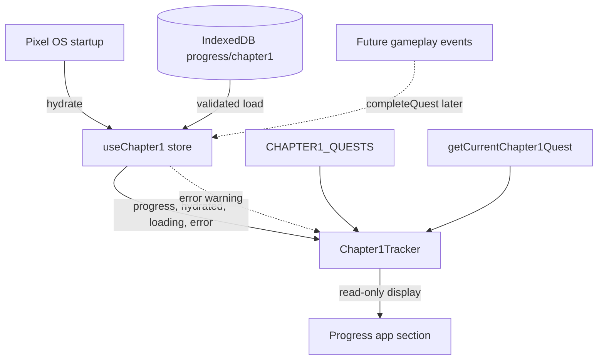

# Chapter 1 Quest Tracker UI — Implementation

**Task:** Stage B, Step 3 — Read-only Chapter 1 quest tracker
**Branch:** `pixelos-dev` · **Status:** Complete

## 1. What was implemented

Added a read-only Chapter 1 tracker to the existing Pixel OS Progress app. It displays:

- Chapter title: **Chapter 1 — The First Paycheck**
- Current quest ID, title, and objective
- Completed quest count against the canonical quest total
- A progress bar and percentage
- Chapter earnings against the Chapter 1 payment amount
- A chapter-complete state after the final quest
- A non-blocking warning when saved progress was recovered or storage failed

The tracker never completes quests. There are no buttons, shortcuts, debug controls, or automatic progression triggers. It only reads the existing `useChapter1` Zustand store.

## 2. Files created and modified

| File | Action | Purpose |
|---|---|---|
| `src/features/chapter1/Chapter1Tracker.tsx` | Created | Read-only tracker component. |
| `src/features/chapter1/chapter1-tracker.css` | Created | Tracker layout and responsive styles. |
| `src/features/chapter1/Chapter1Tracker.test.tsx` | Created | 11 focused React tests. |
| `src/features/progress/ProgressApp.tsx` | Modified | Renders `<Chapter1Tracker />` after the profile hero. |
| `docs/CHAPTER1_TRACKER_UI_IMPLEMENTATION.md` | Created | This document. |

Existing quest definitions, progress logic, store, validation, persistence, XP, tickets, achievements, navigation, and the Godot bridge were not changed.

## 3. How the component reads Zustand state

`Chapter1Tracker` subscribes to the existing store with narrow selectors:

```ts
const progress = useChapter1((state) => state.progress);
const hydrated = useChapter1((state) => state.hydrated);
const loading = useChapter1((state) => state.loading);
const error = useChapter1((state) => state.error);
```

Zustand re-renders the component whenever a selected value changes. No quest state is copied into local React state.

## 4. How the active quest is selected

The tracker calls the existing selector:

```ts
const currentQuest = getCurrentChapter1Quest(progress);
```

It returns the quest at `progress.currentQuestIndex`, or `null` past the end. A `null` result renders the **Chapter complete** state, so completion is handled without duplicating quest logic.

All quest data comes from `CHAPTER1_QUESTS`. The tracker uses `CHAPTER1_QUESTS.length` and the quest's existing `id`, `title`, and `objective` fields.

## 5. Progress and earnings calculations

- **Completed count:** `progress.completedQuestIds.length`, capped at the total.
- **Total:** `CHAPTER1_QUESTS.length`; no hard-coded `8`.
- **Percentage:** `(completedCount / total) * 100`, shown as an integer or one decimal (`12.5%`) and used for the bar width.
- **Accessibility:** the bar exposes `role="progressbar"` with `aria-valuemin`, `aria-valuemax`, `aria-valuenow`, and `aria-valuetext`.
- **Earnings:** `progress.money` over `CHAPTER1_PAYMENT_REWARD`, producing `$0 / $50` before CH1-07 and `$50 / $50` afterwards. The denominator is not hard-coded.

## 6. Loading and error handling

- `!hydrated` renders a status block instead of quest data.
- While `loading` is true, it shows “Loading Chapter 1 progress…”.
- If hydration failed (`hydrated === false`, `error !== null`), it shows “Chapter 1 progress is not available.” so unhydrated initial state is never presented as confirmed progress.
- When `hydrated === true` but `error !== null` (for example invalid saved data was recovered), normal content remains visible and a warning is rendered with `role="alert"`.
- Invalid or unavailable progress never disables the rest of the Progress app.

The tracker does not call `hydrate()` or `completeQuest()`. Startup hydration remains owned by `PixelOS.tsx`, and progression remains owned by future gameplay events.

## 7. Progress app integration

`src/features/progress/ProgressApp.tsx` renders `<Chapter1Tracker />` between the existing profile hero and the Achievements section. The tracker reuses `.cq-progress-section`, `.cq-progress-bar-label`, and `.cq-progress-track`, plus a small dedicated stylesheet.

The existing XP stats, achievement grid, ticket list, ticket-button navigation, window behavior, and root layout are unchanged. No new application or navigation entry was added.

## 8. Data flow



The dotted edge is intentionally not implemented in this step.

## 9. Tests and build results

Focused command: `npx vitest run src/features/chapter1/Chapter1Tracker.test.tsx` — **11 tests passed**.

Coverage: loading before hydration; failed hydration does not present initial progress as saved; initial quest display; one completed quest; percentage, ARIA values, and bar width; earnings before CH1-07; earnings after CH1-07; chapter completion; recovery warning; reactive Zustand updates; existing Progress app sections and ticket buttons intact.

| Command | Result |
|---|---|
| `npm test` | **7 files, 65 tests passed** |
| `npm run build` | **Success** |
| `npx tsc --noEmit` | Only the 4 previously documented unrelated errors |
| ESLint on new TS/TSX files | **Pass** |

`ProgressApp.tsx` retains its existing compact formatting. Its Prettier violations predate this task and were not reformatted to avoid unrelated churn.

## 10. Manual verification

1. Run `npm run dev` and open Pixel OS.
2. Open the **Progress** application.
3. Confirm the tracker shows the chapter title, `CH1-01`, its title, objective, `0 / 8`, `0%`, and `$0 / $50`.
4. Resize the window and confirm the tracker wraps without overlapping.
5. In DevTools console, simulate progression:
   ```js
   const { useChapter1 } = await import("/src/features/chapter1/chapter1Store.ts");
   await useChapter1.getState().completeQuest("CH1-01");
   ```
6. Confirm the tracker updates to `CH1-02` and `1 / 8 · 12.5%`.
7. Complete through CH1-07 and confirm `$50 / $50`; complete CH1-08 and confirm **Chapter complete** and `100%`.
8. To test recovery, corrupt the `chapter1` record in IndexedDB, reload, and confirm a warning appears while the Progress app remains usable.

There are deliberately no in-app completion controls.

## 11. Known limitations

- The tracker is read-only and cannot advance quests by itself.
- Progression requires a future gameplay trigger to call `completeQuest`.
- If hydration fails, the tracker shows an unavailable state; there is no in-tracker retry button.
- Chapter earnings remain local and are not yet connected to a global wallet.
- No cross-tab synchronization exists.
- `ProgressApp.tsx` keeps its pre-existing compact formatting, so a full-file Prettier check still reports the same pre-existing style violations.

## 12. Recommended next step

Connect real gameplay events to `useChapter1.getState().completeQuest(questId)` — for example the GigBoard application, the three Python milestones, and the client payment/delivery flow. Keep those calls outside the tracker so the UI remains a pure, read-only projection of Chapter 1 state.
