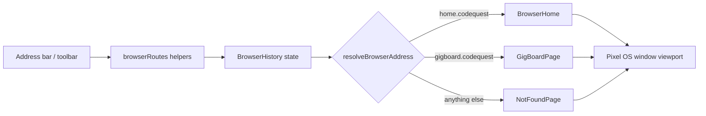

# CodeQuest Browser — Implementation

**Task:** Stage B, Step 4 — Simulated Pixel OS Browser
**Branch:** `pixelos-dev` · **Status:** Complete

## 1. Summary

Added a simulated, network-free browser inside Pixel OS. It renders fictional
CodeQuest websites as ordinary React components, with its own toolbar, address
bar, and session-local history. There are no external requests, iframes, or
parent-app navigations: the Godot game stays mounted at `/game` and the browser
never leaves its Pixel OS window.

Supported addresses in this build:

- `home.codequest` — browser home page with a featured-site link.
- `gigboard.codequest` — GigBoard landing page with the café project preview.

Every other address renders a friendly “Website not found” page.

## 2. Files created and modified

| File | Action | Purpose |
|---|---|---|
| `src/features/browser/BrowserApp.tsx` | Created | Toolbar, address bar, page rendering, history state. |
| `src/features/browser/browserRoutes.ts` | Created | Pure address normalization, routing, and history helpers. |
| `src/features/browser/browser.css` | Created | Browser, home, GigBoard, and not-found styling. |
| `src/features/browser/BrowserApp.test.tsx` | Created | 11 focused Vitest/React Testing Library tests. |
| `src/core/applications/registry.ts` | Modified | Added `browser` to `AppId`, `APPS`, and `APP_ORDER`. |
| `src/shared/components/PixelIcon.tsx` | Modified | Added the `browser` pixel-art icon. |
| `src/app/PixelOS.tsx` | Modified | Rendered `<BrowserApp />` from the app preview switch. |
| `docs/CODEQUEST_BROWSER_IMPLEMENTATION.md` | Created | This document. |

Existing applications, window dragging/resizing, the Godot bridge, and Chapter 1
progression logic were not changed.

## 3. Browser architecture

`BrowserApp` owns three pieces of local React state: `history` (ordered address
list plus current index), `addressInput` (editable address-bar text), and
`refreshKey` (remounts the current page on Refresh). The route table and history
operations live in `browserRoutes.ts` as pure functions, so routing is testable
without rendering the component.

## 4. Internal address routing

`normalizeBrowserAddress` applies the same rules to typed input and stored
history entries:

1. Trim surrounding whitespace.
2. Lowercase the whole address (hostnames are case-insensitive).
3. Strip an optional `http://` or `https://` prefix.
4. Remove trailing slashes.

An empty value resolves to `home.codequest`. `resolveBrowserAddress` then looks
the normalized address up in `KNOWN_ROUTES` and returns either the matching page
descriptor or a `not-found` descriptor that keeps the attempted address visible.

## 5. Navigation and history logic

History is represented as `{ entries: string[], index: number }`.

- **Navigate** — appends the new address after the current index, discarding any
  forward entries, then moves the index to the new entry.
- **Back** — decrements the index while it is greater than zero.
- **Forward** — increments the index while forward entries exist.
- **Home** — navigates to `home.codequest` through the same navigate helper.
- **Refresh** — increments `refreshKey` and restores the current address in the
  input; history and the current entry are untouched.
- **Address bar** — submits on Enter or form submit, then displays the normalized
  current address. Toolbar Back/Forward are disabled when no entry exists.

Because navigation reuses the history helpers, visiting a new page after going
Back clears forward history automatically. History is component-local, so each
browser window has its own stack and nothing is persisted.

## 6. GigBoard landing page

`GigBoardPage` presents GigBoard branding, a short welcome message, and one
project card:

- **Project:** Build a Café Order Calculator
- **Client:** Alex Morgan
- **Payment:** $50 (reuses `CHAPTER1_PAYMENT_REWARD`)
- **Category:** Python / Beginner
- **Description:** a beginner-friendly café receipt calculator.

The card is a preview only. There are no application, messaging, payment, or
quest controls; a notice states these features are “coming in a future update”.
No progression state is read or mutated by the browser.

## 7. Pixel OS integration

The browser is registered as a pinned app (`id: "browser"`, `icon: "browser"`)
in the existing `APPS` registry and `APP_ORDER`. Desktop, taskbar, start menu,
and window management therefore pick it up through the existing mechanisms —
no second window manager was added. `AppPreview` in `PixelOS.tsx` renders
`<BrowserApp />` inside the normal Pixel OS window frame, so dragging, resizing,
minimizing, maximizing, and closing behave like every other app.

## 8. Tests and results

`src/features/browser/BrowserApp.test.tsx` covers: home rendering; the GigBoard
café project preview; Enter navigation; address normalization; unknown-address
fallback; Back; Forward; forward-history clearing; Home; Refresh; and registry /
window-manager launch with pinned status and icon.

Results:

- Focused: `npx vitest run src/features/browser/BrowserApp.test.tsx` — 11/11 passed.
- Full suite: `npm test` — 76/76 tests across 8 files passed.
- Build: `npm run build` — succeeded.
- ESLint on the new browser files and `registry.ts` — clean.

## 9. Manual testing

1. Start with `npm run dev`, open Pixel OS, and launch **Browser** from the
   desktop or taskbar; confirm the home page and `home.codequest`.
2. Type `gigboard.codequest` and press Enter; confirm the café project preview.
3. Use Back, Forward, Home, and Refresh; confirm the address bar follows.
4. Go Back, then visit a new address; confirm Forward becomes disabled.
5. Enter `unknown.example`; confirm the not-found page and recover via Home.
6. Resize, minimize, maximize, and close the window, then open the Godot game
   and another app to confirm nothing else regressed.

## 10. Known limitations

- Only two internal addresses are implemented; there is no page registry UI.
- History is per-window and in-memory; reopening the app starts at home.
- Refresh remounts the page but there is no cache, loading state, or network.
- GigBoard is read-only: no applications, chat, payments, or quest completion.
- Address normalization accepts only http(s) prefixes and exact host routes.

## 11. Recommended next step

Make GigBoard interactive: add an **Apply** flow for the café calculator job that
records the application, then integrate that application with the existing
Chapter 1 quest manager so accepting the project advances the quest through the
normal progression API. Keep the browser network-free and reuse the same route
and history helpers for any additional in-game websites.
