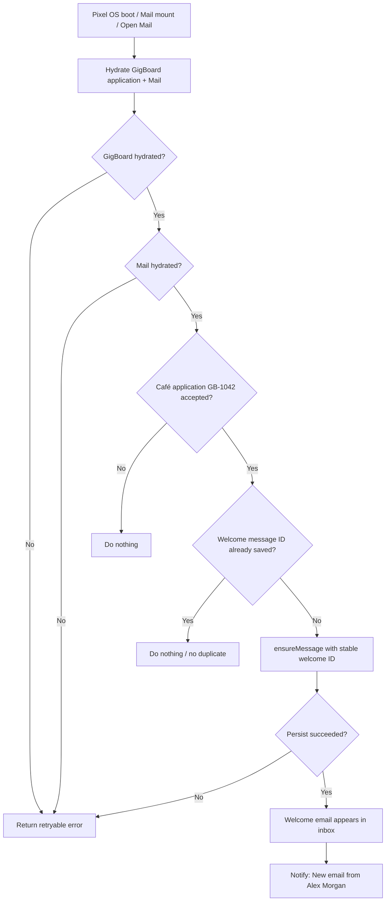

# CodeQuest Mail — Stage B, Step 8B

## 1. Summary

Stage B, Step 8B adds **CodeQuest Mail**, an in-game simulated client email
application built inside the existing Pixel OS. After Alex Morgan accepts the
player's GigBoard Café Calculator proposal, Mail receives a one-time welcome
email describing the project. The player can read the email, reply with
questions, receive deterministic scripted client responses, review sent
messages, and return later with messages and read/unread state restored.

Mail is informational and conversational only. Reading or sending a message
does **not** complete CH1-04, CH1-05, CH1-06, or any other Chapter 1 quest,
does **not** award XP or money, and does **not** change café milestone,
delivery, payment, or GigBoard submission/acceptance logic.

## 2. Architecture

Mail follows the repository's existing patterns rather than introducing new
infrastructure:

- **Pure model** — `mailTypes.ts` owns the versioned persisted envelope, message
  types, IDs, validation, ordering, and unread counting.
- **Persistence adapter** — `mailPersistence.ts` reuses the existing IndexedDB
  `chat` object store under the isolated key `mail-state`. No schema version
  change and no new object store.
- **Store factory** — `mailStore.ts` provides a Zustand store with injectable
  persistence for tests, a serialized write queue, hydration, two-write sending,
  read-state persistence, and retry of incomplete scripted responses.
- **Integration helper** — `mailIntegration.ts` implements the idempotent
  GigBoard acceptance → welcome email synchronization.
- **UI** — `MailApp.tsx` / `mail.css` render the pixel-styled inbox, sent view,
  conversation history, reply composer, and error/retry states.
- **Notifications** — new incoming messages use the existing
  `notificationStore.notify` API.
- **Registration** — Mail is a normal pinned Pixel OS app with a desktop icon,
  taskbar entry, window title, and icon.

Mail state is never stored in `localStorage`; the IndexedDB record is the only
source of truth.

## 3. Files created and modified

### Created

- `src/features/mail/mailTypes.ts` — versioned message model, validation,
  deterministic sorting, unread count, body validation.
- `src/features/mail/mailScripts.ts` — keyword classification and exact
  scripted replies.
- `src/features/mail/mailThreads.ts` — deterministic thread grouping and
  list-preview helpers.
- `src/features/mail/mailPersistence.ts` — `chat/mail-state` persistence
  adapter.
- `src/features/mail/mailStore.ts` — Zustand store, two-write send flow,
  hydration, retries, read state, notifications.
- `src/features/mail/mailIntegration.ts` — idempotent GigBoard acceptance →
  welcome email helper.
- `src/features/mail/MailApp.tsx` — inbox/sent UI, conversation detail, reply
  composer, app integration.
- `src/features/mail/mail.css` — responsive pixel-styled Mail layout.
- `src/features/mail/mailTypes.test.ts`
- `src/features/mail/mailScripts.test.ts`
- `src/features/mail/mailStore.test.ts`
- `src/features/mail/mailIntegration.test.ts`
- `src/features/mail/MailApp.test.tsx`

### Modified

- `src/core/applications/registry.ts` — added `mail` to `AppId`, `APPS`,
  `APP_ORDER`, and the pinned app list.
- `src/app/PixelOS.tsx` — renders `MailApp`, hydrates Mail during boot, runs the
  idempotent welcome-email sync after safe hydration.
- `src/shared/components/PixelIcon.tsx` — added the pixel envelope `mail`
  icon.
- `src/features/browser/pages/GigBoardJobDetails.tsx` — added the **Open Mail**
  action to the accepted café project panel. It runs the same idempotent sync
  and opens Mail through the existing window manager.

### Not changed

- Chapter 1 quest definitions and sequential completion.
- Café Setup tasks and validation.
- Café coding milestones and verification.
- Tickets Step 8A project board behavior.
- GigBoard proposal submission or acceptance logic.
- Temporary GigBoard DEV testing panel.
- Delivery, payment, or milestone refactoring.
- Godot or its bridge.

## 4. Mail data model

`MAIL_VERSION = 1`. The persisted envelope is:

```ts
interface MailSaveRecord {
  readonly version: 1;
  readonly messages: readonly MailMessage[];
}
```

Each `MailMessage` contains:

| Field | Purpose |
| --- | --- |
| `id` | Unique, stable message identifier. |
| `threadId` | Conversation identifier; incoming and outgoing messages share it. |
| `from` / `to` | `{ name, address }` parties. |
| `subject` | Email subject. |
| `body` | Message text. |
| `createdAt` | ISO timestamp used for deterministic ordering. |
| `read` | Persisted read/unread state. |
| `direction` | `incoming` or `outgoing`. |
| `projectId` | Optional; set for project mail. Café mail uses `GB-1042`, the same ID as GigBoard. |
| `scriptedResponseKind` | Optional; `discount`, `prices`, `receipt`, `deadline`, `testing`, or `fallback`. |
| `inReplyTo` | Optional; set on a scripted reply to prevent duplicates. |

Stable identifiers:

- thread: `cafe-calculator-thread`
- welcome email: `mail-cafe-welcome`
- Café project: `GB-1042` (`CAFE_CALCULATOR_JOB_ID`)
- scripted response: `mail-response-${outgoingMessageId}`

Messages are sorted oldest-first by timestamp with the message ID as a
deterministic tie-breaker. Threads are ordered newest-activity-first.

### Validation

`validateMailSaveRecord` rejects malformed records safely: unknown versions,
non-object values, invalid parties/timestamps/directions/read states, invalid
optional fields, and duplicate message IDs. Invalid saves are not loaded, Mail
remains usable, and the reason is shown to the player.

`validateMailBody` normalizes `\r\n` to `\n`, trims surrounding whitespace,
rejects empty messages, and enforces `MAIL_MAX_MESSAGE_LENGTH` (2000
characters).

## 5. Persistence design

- **Store/key:** existing IndexedDB `chat` object store, key `mail-state`. Team
  chat still uses `chat/state`, so the two records never collide.
- **Schema:** unchanged; no new database, object store, or version bump.
- **Writes:** serialized through a promise queue so sends, reads, and retries
  cannot interleave partial writes.
- **Send flow:** the outgoing message is validated, assigned a stable generated
  ID and a timestamp after the newest message, then persisted **before** any
  scripted response is created. Only after that write succeeds is the scripted
  response generated and persisted in a second write.
- **Failure handling:** if the outgoing write fails, nothing is shown as sent
  and the composer keeps the draft. If the response write fails, the outgoing
  message remains saved, the player sees a retry notice, and
  `retryPendingResponses()` repairs the missing response after hydration or on
  the next Mail mount.
- **Deduplication:** a response exists at most once because its ID derives from
  the outgoing message ID and `pendingScriptedResponses` also checks
  `inReplyTo` and existing IDs.
- **Read state:** selecting a conversation marks its incoming messages read and
  persists the updated record. Already-read threads are not re-saved.
- **Corrupted records:** surfaced as a non-fatal error; the inbox opens empty
  and new messages can still be saved.
- **Hydration failure:** `hydrated` stays `false`, so a send cannot overwrite a
  record that failed to load. The app shows a retry action.
- **Reload:** messages, sent messages, read state, and conversation ordering all
  survive reload because they come from the same validated record.

## 6. GigBoard acceptance integration

`syncCafeWelcomeEmail()` is the single idempotent integration point. It is
called from three safe hydration points:

1. Pixel OS boot, after the application and Mail stores hydrate.
2. Mail app mount, after `hydrate()` and `retryPendingResponses()`.
3. The accepted GigBoard project panel's **Open Mail** action.

The helper:

1. Hydrates the GigBoard application store and Mail store.
2. Returns a retryable error if either store failed to hydrate.
3. Checks that the application is `status === "accepted"` **and**
   `jobId === GB-1042`.
4. Checks that `mail-cafe-welcome` is not already present.
5. Creates exactly one welcome email with a stable ID and persists it.
6. Emits one notification only after persistence succeeds.

Because the welcome email has a stable ID and `ensureMessage` checks existing
IDs, repeated boot/mount/action calls cannot duplicate it. An application
accepted before Mail existed is handled by the same path on the next safe
hydration. Unrelated jobs are ignored.



## 7. Scripted response rules

Classification is keyword-based and deterministic. There is no AI service,
API key, or network request. The first matching topic wins, in this explicit
precedence order:

| Order | Kind | Example triggers | Exact reply |
| --- | --- | --- | --- |
| 1 | `discount` | discount, 10%, threshold, $20 | The 10% discount should apply when the order subtotal is $20 or more, including exactly $20. |
| 2 | `prices` | price, cost, coffee, sandwich, $3, $5 | Coffee costs $3 and sandwiches cost $5. These prices should remain fixed for this project. |
| 3 | `receipt` | receipt, output, print, show items/total | The receipt should show the items ordered, subtotal, any discount applied, and the final total. |
| 4 | `deadline` | deadline, due, timeline, how long, when finish/done/deliver | There's no strict real-time deadline for this project. Focus on making sure the program works correctly. |
| 5 | `testing` | test, invalid, zero, negative, edge case, quantity, input | Please test normal orders, zero quantities, negative quantities, invalid input, and the discount threshold. |
| 6 | `fallback` | anything else | Thanks for your message. Could you clarify your question? I can help with the café requirements, prices, discounts, receipts, or testing. |

Precedence matters. For example, "Is the discount applied to the $3 coffee?"
returns the discount answer, not the prices answer.

Scripted replies are generated only for the Café Calculator conversation.
Other threads can be sent to, but do not receive an automated response. The
response appears immediately after the outgoing message is durably saved; no
artificial timers are used.

## 8. Notification integration

`mailStore` calls the existing `notify()` API with:

- `kind: "info"`
- title: `New email from <sender>`
- message: the email subject

Notifications are emitted only after the corresponding Mail record has been
persisted successfully. Welcome-email deduplication comes from the stable
message ID, and scripted replies are notified once when created. Reloading an
already-persisted conversation does not re-notify, because notifications are
only triggered by newly created messages, not by hydration.

The notification system does not keep a separate durable notification log.
Durability is provided by the Mail record itself: a message that already exists
is never re-created, so it cannot trigger a second notification.

## 9. Manual browser testing

The following smoke test should be repeated in a real browser; it is not
automated end-to-end in this environment:

1. Start from a save where the Café Calculator application is **accepted**.
2. Confirm the Mail icon appears on the desktop/taskbar and opens a window with
   the correct title and icon.
3. Confirm the inbox contains exactly one welcome email from Alex Morgan with
   the Café Calculator requirements.
4. Confirm the unread count is correct, select the conversation, and confirm it
   is marked read and the badge clears.
5. Send each topic — discount, prices, receipt, deadline, testing — and confirm
   the exact scripted reply for each.
6. Send an unrelated question and confirm the polite fallback.
7. Confirm the outgoing message appears in **Sent** and in the conversation
   history.
8. Confirm a notification appears for the welcome email and for each scripted
   reply, and that reloading does not repeat notifications.
9. Reload the page and confirm messages, sent messages, read/unread state, and
   thread ordering are preserved.
10. In GigBoard, open the accepted café project panel and use **Open Mail**;
    confirm Mail opens and no duplicate welcome email is created.
11. Use **Open Tickets** from the conversation and confirm it opens the existing
    Tickets app.
12. Confirm reading and replying does not complete a Chapter 1 quest and does
    not change XP or money.
13. Submit an application for a different job and confirm no café welcome email
    is created.

## 10. Test results

Focused Mail tests:

- `npx vitest run src/features/mail` — **5 files passed, 54 tests passed**.

Full suite:

- `npm test` (default parallel execution) — **304/305 tests passed**. The single
  failure was the pre-existing `CafeProjectGuidancePanel.test.tsx` async UI
  timing test, which passed in isolation. Repeated parallel runs showed the
  same environment-sensitive timing behavior, and one run also timed out in
  `TicketsApp.test.tsx`. Neither file imports Mail.
- `npx vitest run --maxWorkers=1` — **32 files passed, 305 tests passed**,
  confirming the full suite is green when parallel CPU contention is removed.

Build:

- `npm run build` — **passed** (client and Nitro production builds completed).

Lint:

- Targeted `eslint` on `src/features/mail`,
  `src/core/applications/registry.ts`, and
  `src/features/browser/pages/GigBoardJobDetails.tsx` — **clean** after
  formatting the new Mail files.

Type checking:

- `npx tsc --noEmit` reports no errors in new Mail files, the Mail registration
  changes, or the GigBoard action changes. The command still exits non-zero
  because of unrelated pre-existing errors in other files.

Coverage includes app registration, inbox/sent views, thread selection,
read/unread state, sending, empty/oversized validation, persistence and reload,
corrupted records, hydration and save failure, welcome email conditions and
idempotency, legacy accepted applications, unrelated jobs, every scripted
response plus fallback and precedence, response deduplication, retry after
partial persistence failure, notification behavior, and no XP/money/quest
changes.

## 11. Known limitations

- Mail is simulated. No real email is sent or received.
- Scripted replies exist only for the Café Calculator conversation. Other
  threads have no automated client response.
- Responses appear immediately rather than after a simulated delay.
- Mail supports one Café thread and generic threads; there is no attachment,
  search, delete, or multi-recipient UI.
- Notifications are not stored in a separate durable log; deduplication relies
  on the Mail message IDs.
- Selecting a conversation marks it read; there is no explicit "mark unread"
  control.
- Under heavy parallel test load on this machine, the pre-existing café setup
  and Tickets component tests can intermittently fail on async UI timing. They
  pass in isolation and in serial full-suite runs.
- Legacy minified `PixelOS.tsx` / `PixelIcon.tsx` and other older files retain
  their pre-existing Prettier lint debt; they were not reformatted wholesale.

## 12. Next recommended step

The next step should implement the post-3/3 delivery and payment flow without
changing this Mail foundation: allow the player to submit the finished café
project, have Alex respond to delivery, and handle the $50 payment and CH1-06
handoff. Mail can then carry the delivery conversation while Tickets continues
to own technical tasks and the Editor remains a clean coding workspace.
