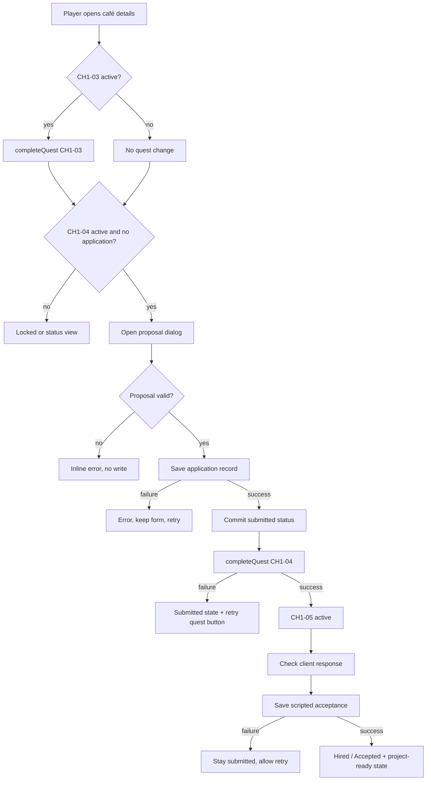

# GigBoard Café Application & Chapter 1 Integration

**Task:** Stage B, Step 5 — GigBoard job application and Chapter 1 integration
**Branch:** `pixelos-dev`
**Status:** Complete for the scoped application flow

## 1. Summary

The café calculator listing now has a persistent application workflow: discover the job, open its details, write a proposal, submit once, view status, receive Alex Morgan's scripted acceptance, and see the project-ready state.

Opening the job details through explicit GigBoard navigation completes CH1-03 when active. A successful application save completes CH1-04 when active. CH1-05 stays incomplete. The other six listings remain browsing-only. No payment, XP, Python milestone, editor, runner, or Godot change was made.

## 2. Files created and modified

### Created

| File | Purpose |
|---|---|
| `src/features/browser/data/gigboardApplication.ts` | Types, proposal validation, versioned save envelope, scripted acceptance, milestones. |
| `src/features/browser/gigboardApplicationStore.ts` | Hydration, serialized saves, duplicate protection, submission, scripted acceptance. |
| `src/features/browser/gigboardApplicationStore.test.ts` | 20 store tests. |
| `src/features/browser/GigBoardApplication.test.tsx` | 10 UI/integration tests. |
| `docs/GIGBOARD_APPLICATION_IMPLEMENTATION.md` | This document. |

### Modified

| File | Change |
|---|---|
| `src/features/browser/data/gigboardJobs.ts` | Canonical café job ID/slug constants. |
| `src/features/browser/pages/GigBoardJobDetails.tsx` | Application panel, proposal dialog, status, acceptance, project-ready view. |
| `src/features/browser/BrowserApp.tsx` | Explicit job-details navigation triggers CH1-03. |
| `src/features/browser/browser.css` | GigBoard application, dialog, warning, and project-ready styles. |
| `src/features/browser/BrowserApp.test.tsx` | Updated job-details assertions. |
| `src/app/PixelOS.tsx` | Hydrates the application store during existing startup restore. |

Unchanged: Chapter 1 pure quest logic, persistence database helpers, ticket/XP logic, Python editor, Pyodide runner, and Godot bridge.

## 3. Application state model

```ts
type GigboardApplicationStatus = "submitted" | "accepted";

interface GigboardApplication {
  jobId: "GB-1042";
  proposal: string;
  status: "submitted" | "accepted";
  submittedAt: string;       // ISO timestamp
  acceptedAt: string | null;
  acceptanceMessage: string | null;
}
```

`not-applied` is represented by `application === null`; no placeholder is written. Only the café job (`GB-1042`) is valid. An `accepted` record must contain both an ISO `acceptedAt` and the exact scripted message; a `submitted` record must contain neither. Proposals are trimmed, preserve newlines, and must be 40–1200 characters.

## 4. IndexedDB persistence and validation

The application uses the existing `progress` object store under an isolated key:

```ts
GIGBOARD_APPLICATION_STORAGE_STORE = "progress";
GIGBOARD_APPLICATION_STORAGE_KEY = "gigboard-application-cafe-calculator";
```

`DB_VERSION` stays `1`; no migration or new store was added. `progress/state` (tickets/XP) and `progress/chapter1` are untouched.

Every write is `{ version: 1, application }`. `validateApplicationSaveRecord` rejects wrong versions/job IDs, invalid proposals/statuses/timestamps, forged acceptance text, and inconsistent status metadata. Invalid data falls back to "not applied", reports an error, and is replaced only by the next successful save. A read failure keeps `hydrated = false` so a player action cannot overwrite an unread save. Hydration runs at Pixel OS startup and defensively when the café details page mounts; repeated calls are deduplicated.

## 5. Proposal submission flow

1. Apply is enabled only when Chapter 1 is hydrated and CH1-04 is active.
2. The dialog shows project title, client, budget, proposal textarea, and character count.
3. Local validation shows an inline error for empty, short, or oversized text; no write occurs.
4. The store re-validates, rejects duplicates, and saves through `trackedSave`.
5. State commits only after the write succeeds. The button shows "Saving application…" while pending.
6. The dialog closes and the panel shows "Application submitted", the proposal, and the submission time.
7. Duplicates are impossible: the UI replaces Apply with the status panel, and the store rejects repeated and concurrent calls.

If the save fails, no application state is committed; the form stays open with an error and can be retried.

## 6. Scripted client response

The deterministic local message is:

```text
Hi! Thanks for applying. Your proposal looks promising. I'd like to hire you
for the café order calculator project. Let's get started!
```

**Exact trigger:** after a successful submission, the player clicks **Check client response** in the café application panel. No timer, render effect, API, server, or fake AI service is involved. The button calls `useGigboardApplication.getState().acceptApplication()`.

The acceptance goes through the same validated persistence path. If that save fails, the application remains truthfully "submitted" and the button can be used again. Once accepted, the store is idempotent and does not write again. There is no UI for the player to act as the client.

## 7. Quest progression integration

| Quest | Trigger | Guard |
|---|---|---|
| CH1-03 | Explicit navigation to `gigboard.codequest/jobs/cafe-calculator` through GigBoard's `goTo` (job card, address bar, bookmark, or in-site link). | `completeQuest("CH1-03")` advances only when CH1-03 is active. Back/forward and render effects do not trigger it. |
| CH1-04 | After a successful application save, `completeQuest("CH1-04")` is called explicitly. | The form opens only when CH1-04 is active; the submit handler re-checks immediately before saving. |
| CH1-05 | Not completed in this step. | Acceptance only makes the project ready for future coding milestones. |

CH1-01 and CH1-02 cannot be skipped. Earlier quests show a story-appropriate locked state and a disabled Apply button. No earlier quest is auto-completed, and no money or XP is granted.

### CH1-04 consistency

- Application saved, quest saved → submitted status and CH1-05 active.
- Application save failed → no application, no quest call, safe retry.
- Application saved, quest failed → application stays submitted, progress stays on CH1-04. The panel shows a warning and **Retry Chapter 1 update**. Retrying only runs `completeQuest("CH1-04")`; it never resubmits the proposal.

## 8. Failure recovery and duplicate protection



Duplicate protection exists at both layers: the UI removes Apply once an application exists, and the store's serialized queue re-checks before writing. Acceptance save failures keep the submitted state and are retryable.

## 9. Project-ready state

After acceptance the player sees:

- Status: **Hired / Accepted**
- Project: **Build a Café Order Calculator**
- Client: **Alex Morgan**
- Budget: **$50**
- Informational milestones: **Variables and print**, **Arithmetic and functions**, **Conditional discounts**

No milestone is marked complete. The `$50` payment is not granted; Chapter 1 money remains `$0` with `paymentClaimed: false`.

## 10. Tests and build results

Focused command:

```bash
npx vitest run src/features/browser/gigboardApplicationStore.test.ts src/features/browser/GigBoardApplication.test.tsx src/features/browser/BrowserApp.test.tsx
```

Result: **50 tests passed across 3 files**. Coverage includes form opening, validation, cancel, submission, duplicate prevention (including concurrent), reload persistence, invalid-data recovery, scripted acceptance, acceptance persistence, CH1-03 only when active, CH1-04 only after valid submission, earlier-quest lockout, CH1-05 remaining incomplete, no money/XP, application save failure, quest save failure with safe retry, browsing-only jobs, and existing browser navigation/filters.

| Command | Result |
|---|---|
| `npm test` | **10 files, 115 tests passed** |
| `npm run build` | **Success** |
| `npx eslint` on new/changed browser files | **Pass** |
| `npx tsc --noEmit` | Only the 4 known pre-existing errors |

Known pre-existing TypeScript errors remain in `src/app/PixelOS.tsx`, `src/features/editor/EditorApp.tsx`, and `src/features/terminal/TerminalApp.tsx`. `PixelOS.tsx` also has pre-existing Prettier violations from its original compact formatting; only the two required import/hydration edits were made there.

## 11. Manual browser testing

1. Run `npm run dev`, open Pixel OS, and complete CH1-01/CH1-02 through normal gameplay.
2. Open the Browser, visit `gigboard.codequest/jobs`, and confirm Apply is locked before CH1-03.
3. At CH1-03, click **View details** on the café job. Confirm CH1-03 advances and Apply unlocks.
4. Click **Apply for Project**. Confirm the dialog shows the title, Alex Morgan, `$50`, and the textarea.
5. Submit a short proposal and confirm validation. Cancel and confirm nothing is saved.
6. Submit a valid proposal. Confirm "Application submitted", CH1-04 completion, and CH1-05 as active.
7. Click **Check client response**. Confirm Alex's message, Hired/Accepted, and the three milestones.
8. Reload and revisit the café job. Confirm the accepted status and message persist.
9. In IndexedDB → `codequest-pixel-os` → `progress`, confirm the isolated application key; `chapter1` and `state` still exist.
10. Corrupt the application record and reload. Confirm fallback to not-applied with an error, not a crash.
11. Confirm other listings keep disabled Apply buttons and never open the dialog.

## 12. Known limitations

- Only the café listing accepts applications.
- Proposals are plain text; there is no draft autosave, attachment, or rich text.
- Acceptance is a scripted local response, not an inbox or messaging timeline.
- There is no rejection path, contract, or payment.
- The three Python milestones are informational with no completion triggers yet.
- Multi-tab coordination is absent; the latest absolute record wins.
- Browser shutdown before an IndexedDB commit can lose that action.
- Chapter 1 hydration remains one-time per session after success.

## 13. Recommended next step

Implement CH1-05 safely without changing the Python runner's public behavior:

1. Add explicit, testable milestone checks for variables/print, arithmetic/functions, and conditional discounts.
2. Connect verified milestones to the existing Python editor test flow and show progress in the project-ready panel.
3. Complete CH1-05 only after all three milestones are verified through the existing quest store API.
4. Keep CH1-06 delivery and CH1-07 payment out of scope until that milestone flow is stable.
