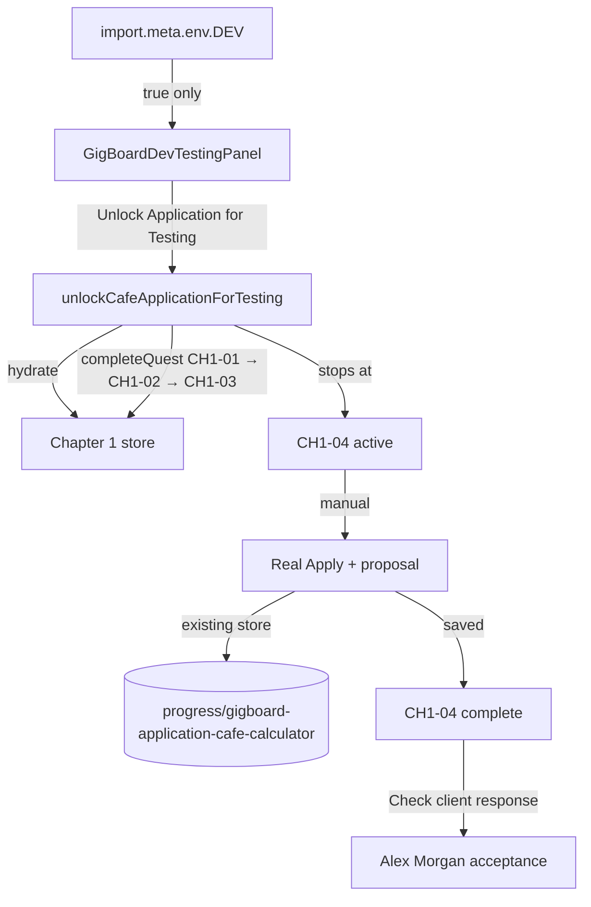

# GigBoard Temporary Application Test Mode

## 1. What was added

A temporary, development-only control on the GigBoard **Build a Café Order
Calculator** job page that advances the Chapter 1 story far enough to test the
real job application workflow before the Godot Chapter 1 missions exist.

The panel is titled **"Development Testing — Café Job"** and contains one
button: **"Unlock Application for Testing"**.

The implementation is intentionally small and reuses the existing systems:

- `completeQuest()` from the existing Chapter 1 store.
- The existing GigBoard application store and submission action.
- The existing proposal validation (40–1200 characters).
- The existing "Check client response" acceptance flow.
- The existing CH1-04 completion after a successful application save.

No second application system, quest bypass, or direct state mutation was added.



## 2. How to activate the development controls

1. Run the app in development mode:

```bash
npm run dev
```

2. Open the Pixel OS browser and navigate to GigBoard.
3. Open **Build a Café Order Calculator**.
4. In the right-hand column, find **Development Testing — Café Job**.
5. Click **Unlock Application for Testing**.

The control is only rendered when `import.meta.env.DEV` is `true`. The helper
itself also refuses to run when that flag is false, so it cannot be triggered
in a production build even if called directly.

The unlock action:

- Hydrates the existing Chapter 1 store when necessary.
- Completes CH1-01, CH1-02, then CH1-03 in order using `completeQuest()`.
- Skips quests that are already complete.
- Stops as soon as CH1-04 is active.
- Never submits a proposal or accepts the application.
- Writes through the normal persisted Chapter 1 save path; it never mutates
  quest state directly.

If a save fails, the panel shows an error and the job stays locked. If
persisted progress is already past CH1-04, the action reports that the
application stage is behind you rather than regressing progress.

## 3. How to test the application

1. After unlocking, the panel reports that Chapter 1 advanced to CH1-04.
2. Click **Apply for Project**. The button is enabled only when:
   - the job is the café project,
   - CH1-04 is the active Chapter 1 quest,
   - the Chapter 1 and application stores are hydrated,
   - no application already exists,
   - no submission is in progress.
3. Write a proposal between **40 and 1200 characters**.
4. Click **Submit proposal**.

Proposals that are empty, too short, or too long are rejected with the existing
validation message and are not saved. The normal application store persists the
submission and the existing application action completes CH1-04 only after that
save succeeds. If an application already exists, its status is shown instead of
an Apply button, so duplicate submissions are not possible.

## 4. How to verify Alex Morgan's acceptance

1. With the application showing **Application submitted**, click
   **Check client response**.
2. The existing scripted flow updates the application to **Hired / Accepted**
   and shows Alex Morgan's acceptance message.
3. The café project panel becomes available in the Editor.
4. CH1-05 is now the active Chapter 1 quest.

This mode does not auto-accept, does not write the acceptance itself, and does
not grant money or XP.

## 5. How to remove the temporary controls after Godot integration

Once the real Godot Chapter 1 missions complete CH1-01 through CH1-03, remove:

- `src/features/browser/devGigboardTesting.ts`
- `src/features/browser/pages/GigBoardDevTestingPanel.tsx`
- `src/features/browser/devGigboardTesting.test.ts`
- `src/features/browser/GigBoardDevMode.test.tsx`
- The `.cq-gb-dev-*` rules in `src/features/browser/browser.css`

Then in `src/features/browser/pages/GigBoardJobDetails.tsx`:

- Remove the `isDevTestingEnabled` and `GigBoardDevTestingPanel` imports.
- Remove the `devTestingEnabled` prop and its use.
- Remove the `<GigBoardDevTestingPanel … />` block.

Also delete this document. No other code depends on the dev module, so removal
is self-contained. The production gating rules in `canApply`, `handleSubmit`,
and the `CH1-04` requirement stay in place.

## 6. Test results

Focused tests:

- `src/features/browser/devGigboardTesting.test.ts`
- `src/features/browser/GigBoardDevMode.test.tsx`
- Existing GigBoard suite: **65 passed / 5 files**

Full suite: **189 passed / 18 files**.

Production build: **passed** (`npm run build`).

ESLint on the new and modified files: **passed**.

Focused coverage includes:

- The unlock advances only CH1-01 through CH1-03.
- CH1-04 becomes active.
- No application is submitted automatically.
- Apply is enabled for a valid proposal on CH1-04.
- Invalid proposals stay blocked and CH1-04 remains active.
- An existing application cannot be duplicated.
- The development panel is unavailable when dev mode is disabled.
- Production quest gating is unchanged.
- Save and hydration failures show an error instead of unlocking the job.
- Already-completed quests are not completed again.
- A Chapter 1 past CH1-04 is not regressed.

## 7. Known limitations

- This is a development-only shortcut. It is not available in production
  builds and must be removed after the Godot missions land.
- It intentionally advances the story to CH1-04, so using it changes the local
  Chapter 1 save for the current browser profile.
- It uses the existing IndexedDB save path; automated tests stub persistence
  because jsdom has no IndexedDB.
- It does not reset or repair unrelated progress, and there is deliberately no
  reset button.
- No Git, Godot, bridge, milestone, money, or XP behavior was changed.
