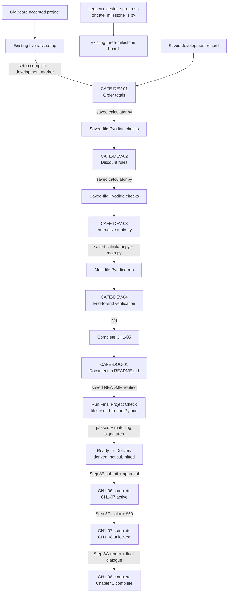
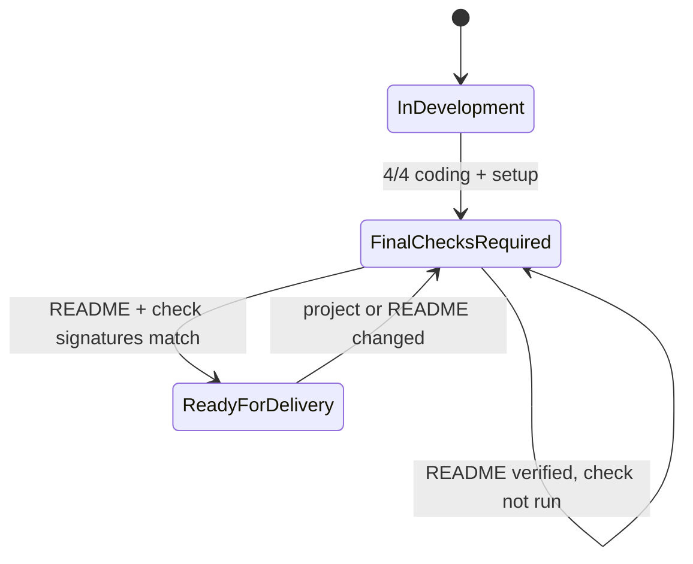
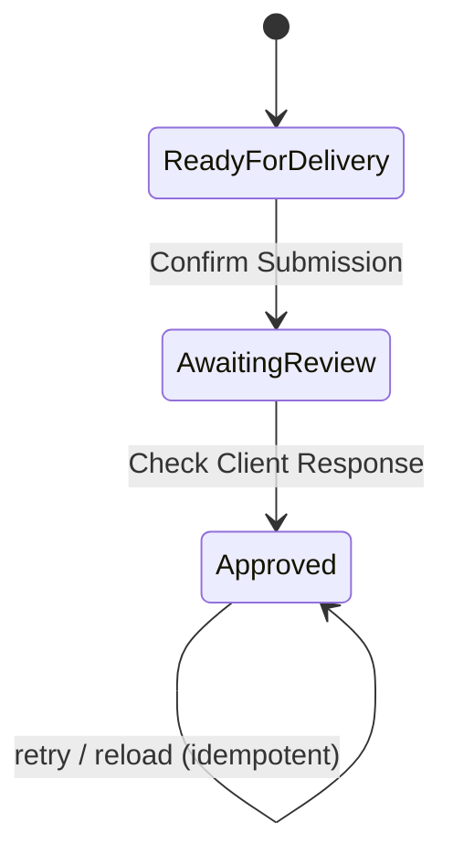
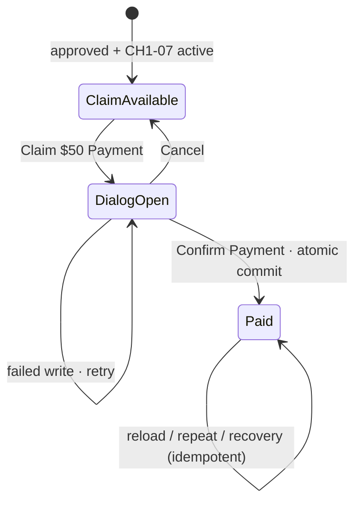
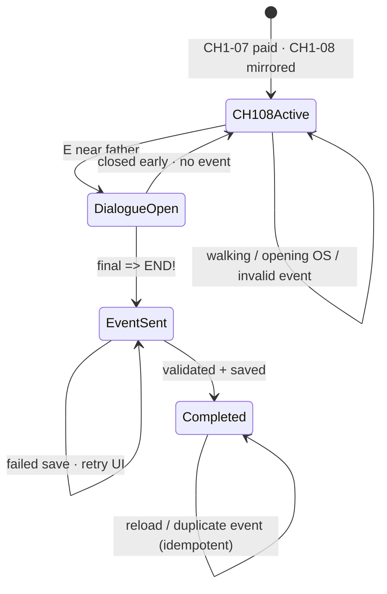

# Real Café Calculator — Implementation

## 1. Summary

Stage B, Step 8C replaces the three disconnected café coding exercises for new
saves with a coherent four-task, multi-file Python project. After the existing
setup phase creates `PLAN.md`, `calculator.py`, `main.py`, and `README.md`, the
player builds the project through Tickets:

1. `CAFE-DEV-01` — implement prices and `calculate_total()` in `calculator.py`.
2. `CAFE-DEV-02` — add the $20 discount rule in `calculator.py`.
3. `CAFE-DEV-03` — write the interactive receipt in `main.py`.
4. `CAFE-DEV-04` — verify the complete program end to end.

Tickets owns the instructions, hints, acceptance criteria, and verification.
The Editor only hosts the player's saved files. Verification always reads the
saved `calculator.py`/`main.py` contents, never an unsaved buffer, and is blocked
while either required file has unsaved editor changes.

The project is not auto-created, completed, or injected. It grants no XP, money,
delivery, or payment and does not complete CH1-05 until all four tasks pass.
A fresh save now starts on this four-task project. Existing three-milestone
saves keep the legacy board unchanged.

Stage B, Step 8D adds the documentation and delivery-preparation phase on top of
the same four tasks:

1. `CAFE-DOC-01` — document the application in `README.md` (unlocks only after
   4/4 coding tasks pass).
2. **Verify Documentation** — deterministic analysis of the saved `README.md`.
3. **Run Final Project Check** — re-read the saved project, confirm all required
   files exist, re-run the end-to-end Python tests, and record readiness.
4. **Ready for Delivery** — a derived status, never a button click. Nothing is
   submitted, no client approval happens, and no payment, XP, money, or CH1-06
   change is made.

Stage B, Step 8E adds the explicit submission and deterministic Alex Morgan
approval: a byte-for-byte immutable four-file snapshot, `mail-cafe-approval`,
CH1-06 completion, and CH1-07 unlock. It still grants no money.

Stage B, Step 8F adds the one-time $50 café payment claim. The player must
actively confirm **Claim $50 Payment** after approval. One atomic IndexedDB
commit writes both the versioned payment record and the existing Chapter 1
money/quest progress, so the wallet is credited exactly once, CH1-07 completes,
CH1-08 unlocks, and a single `mail-cafe-payment` message is deduped through
Mail. No external payment or second wallet is introduced.

Stage B, Step 8G completes the story loop. CH1-08 stays active with the exact
objective `Return home and talk to your father.` until the player physically
returns to the father in Godot, presses E, and advances the new final dialogue
to its true end. Only then does Godot emit one validated completion event that
React turns into CH1-08 completion and Chapter 1 completion. The paid café
record, wallet, café files/submission/emails, and legacy saves are consumed as
evidence, not recreated or modified. There is no Chapter 2, new economy,
additional job, second wallet, cloud save, or multiplayer.



## 2. Workflow selection and compatibility

`cafeWorkflow.ts` selects exactly one workflow and one matching count. Legacy
and development progress are never added together, so the header cannot show
`3/4` or `4/3`. Selection is deterministic:

1. Legacy milestone index above 0, or an existing
   `/Projects/Python/cafe_milestone_1.py`, selects **legacy**.
2. A valid saved development record selects **development**.
3. A completed CH1-05 without a development record selects **legacy**.
4. A completed setup record stamped with `workflow: "development"` selects
   **development**.
5. Fresh or unknown saves fall back to **development**, because the four-task
   project is the current workflow. An older save with zero legacy progress is
   migrated to the four-task project; nothing is discarded.

Legacy evidence always wins over the fresh-save default, so existing players
keep the three-milestone board. Both Tickets and GigBoard run the same legacy
detection (`detectLegacyCafeProjectFiles()`), so the chosen workflow cannot
differ between apps. GigBoard previously hard-coded `legacyMilestoneFileExists`
to `false`; it now reads the real filesystem.

The existing three-milestone record and board remain untouched. Step 8C adds a
separate `chapter1-cafe-development-project` record, so no legacy save is
reinterpreted or migrated.

The setup marker is written by `cafeSetupStore.completeTask` after the final
setup task saves. Pure `completeCafeSetupTask` helpers and older fixtures do not
stamp the marker. A fresh save therefore reaches the four-task project through
the fallback rather than the marker.

## 3. Files created and modified

Created under `src/features/chapter1/cafeCoding/`:

- `cafeDevTasks.ts` — four canonical task definitions, canonical project
  directory, required files, instructions, hints, acceptance tests.
- `cafeDevProgress.ts` — pure prefix progress, versioned save envelope,
  untrusted-data validation.
- `cafeDevStore.ts` — Zustand store, IndexedDB hydration, serialized writes,
  commit-after-save, retryable errors, CH1-05 sync error state.
- `cafeDevFiles.ts` — saved-file reads, editor opening, path helpers.
- `cafeDevValidator.ts` — executable checks through the existing Pyodide
  runner; `calculator.py` alone for tasks 1–2, `main.py` plus a fresh
  `calculator` module for tasks 3–4. Output checks support tolerant receipt
  regexes and per-test module overrides.
- `cafeDevTaskStatus.ts` — pure task status and Open/Verify action decisions.
- `cafeDevTaskVerification.ts` — saved-file verification, unsaved-change
  blocking, store completion, CH1-05 sync.
- `cafeWorkflow.ts` — workflow selection and non-mixed progress summary.
- Focused tests: `cafeDevProgress.test.ts`, `cafeDevStore.test.ts`,
  `cafeWorkflow.test.ts`, `cafeDevValidator.test.ts`,
  `cafeDevTaskStatus.test.ts`, `cafeDevTaskVerification.test.ts`.

Created for Step 8D under `src/features/chapter1/cafeCoding/`:

- `cafeDocTask.ts` — `CAFE-DOC-01` definition, `README.md` path, instructions,
  three progressive hints, and a deliberately partial outline/example.
- `cafeDocReadme.ts` — tolerant deterministic analysis of the seven required
  documentation areas with specific missing-area feedback.
- `cafeDocProgress.ts` — versioned documentation/delivery save envelope,
  untrusted-data validation, and readiness transitions.
- `cafeDocStore.ts` — Zustand store with hydration, serialized writes, and
  commit-after-save.
- `cafeDocFiles.ts` — opens `README.md` in the existing editor.
- `cafeDocVerification.ts` — saved-file README verification, unsaved-change
  blocking, and persistence integration.
- `cafeDelivery.ts` — status evaluation, labels, fingerprints, saved project
  snapshot reader.
- `cafeDeliveryVerification.ts` — setup/dev/documentation/file/test checks and
  final delivery recording.
- `cafeDeliveryStatus.ts` — shared readiness hook used by Tickets and GigBoard.
- Focused tests: `cafeDocReadme.test.ts`, `cafeDocProgress.test.ts`,
  `cafeDocStore.test.ts`, `cafeDocVerification.test.ts`, `cafeDelivery.test.ts`,
  `cafeDeliveryVerification.test.ts`.

Created for Step 8D elsewhere:

- `src/features/tickets/CafeDeliveryPreparation.tsx` — “Project Delivery
  Preparation” section in Tickets.
- `src/features/tickets/CafeDeliveryPreparation.test.tsx`.
- `src/features/browser/pages/CafeGigBoardDelivery.tsx` — read-only GigBoard
  readiness panel.
- `src/features/browser/GigBoardDeliveryReadiness.test.tsx`.

Modified for Step 8D:

- `src/features/tickets/CafeDevelopmentBoard.tsx` and
  `CafeDevelopmentBoard.test.tsx` — render the delivery section, replace the
  premature “ready for delivery” messaging.
- `src/features/browser/pages/GigBoardJobDetails.tsx` — workflow-aware accepted
  project section.
- `src/features/tickets/cafe-project-board.css`,
  `src/features/browser/browser.css` — delivery styles.

Created for Step 8F under `src/features/chapter1/cafeCoding/`:

- `cafePayment.ts` — versioned payment record, strict hydration validation,
  eligibility rules, and pure commit planning.
- `cafePaymentCommit.ts` — atomic `progress` store adapter with `add`-based
  duplicate guard.
- `cafePaymentStore.ts` — hydrated Zustand store that never overwrites a valid
  existing record.
- `cafePaymentService.ts` — claim orchestration, Mail dedupe, retry, and
  recoverable CH1-07 quest sync without a second credit.
- Focused tests: `cafePayment.test.ts`, `cafePaymentStore.test.ts`,
  `cafePaymentService.test.ts`.

Created for Step 8F elsewhere:

- `src/features/browser/pages/CafeProjectPayment.tsx` — recipient/project/
  amount/status UI, confirmation dialog, cancel/confirm, success copy, and
  retry affordances.
- `src/features/browser/GigBoardPayment.test.tsx` — eligibility, dialog,
  cancel, amount, exactly-once, reload, and progression UI tests.

Modified for Step 8F:

- `src/services/persistence/db.ts` — `dbAtomic<T>()` for one IndexedDB
  transaction across multiple store writes.
- `src/services/persistence/saveStatus.ts` — `trackedTransaction<T>()`
  progress tracking for atomic saves.
- `src/features/chapter1/chapter1Store.ts` — `adopt()` for already-committed
  atomic progress.
- `src/features/mail/mailTypes.ts` — `scriptedResponseKind: "payment"`.
- `src/features/browser/pages/CafeGigBoardDelivery.tsx` — mounts the payment
  panel after approval.
- `src/app/PixelOS.tsx` — hydrates the payment store at OS startup.
- `src/features/browser/browser.css` — payment panel and dialog styling.
- `src/features/browser/GigBoardSubmission.test.tsx` — store reset isolation.

Created for Step 8G:

- `src/features/chapter1/godotBridge.ts` — validated same-origin bridge contract,
  state mirror builder, one-shot/retry completion handler, and the exact
  notification copy.
- `src/features/chapter1/godotBridge.test.ts` — payload/message validation,
  guard matrix, dedupe, retry, and notification tests.
- `src/routes/-game.test.tsx` — route-level state mirroring, listener filtering,
  banner, and unchanged `codequest:open-os` behavior.
- `godot-source/MVPCODE (1)/MVPCODE/MVPCODE/RESOURSEDIA/father_return.dialogue`
  plus its `.import` file — the final father dialogue, ending with `=> END!`.
- `godot-source/MVPCODE (1)/MVPCODE/MVPCODE/script/codequest_bridge.gd` —
  reads `window.__codequestChapterState`, selects the return dialogue only for
  CH1-08, and emits the completion event only after true dialogue end.

Modified for Step 8G:

- `src/routes/game.tsx` — hydrates both stores, publishes the state mirror to
  the parent window and iframe, validates the completion message, renders the
  success/retry banner, and leaves `codequest:open-os` unchanged.
- `src/features/chapter1/chapter1Quests.ts` — exact CH1-08 objective and exact
  Chapter 1 completion title/message.
- `src/features/chapter1/chapter1Validation.ts` and `chapter1Store.ts` —
  consistent payment-flag validation and larger-wallet acceptance.
- `src/features/chapter1/Chapter1Tracker.tsx` and its test — exact tracker
  completion copy.
- `godot-source/MVPCODE (1)/MVPCODE/MVPCODE/scene/actionable.gd` — E interaction
  chooses the return dialogue, connects `DialogueManager.dialogue_ended`, and
  emits only once per successful true end.
- `godot-source/MVPCODE (1)/MVPCODE/MVPCODE/scene/father.gd` — CH1-08 objective
  sync/poll from the mirrored React state.
- `godot-source/MVPCODE (1)/MVPCODE/MVPCODE/scene/Game.tscn` — father prompt,
  return dialogue resource, and `CH1-08` completion wiring.
- `public/godot/` — regenerated clean Web export.

Created elsewhere:

- `src/features/editor/projectModules.ts` — loads valid sibling `.py` files for
  a file-mode Run.
- `src/features/editor/projectModules.test.ts`.
- `src/features/tickets/CafeDevelopmentBoard.tsx` — four-task board.
- `src/features/tickets/CafeDevelopmentBoard.test.tsx`.
- `src/features/chapter1/cafeSetup/cafeSetupWorkflow.test.ts`.

Modified:

- `src/features/chapter1/cafeCoding/cafeQuestSync.ts` — separate development
  CH1-05 adapter.
- `src/features/chapter1/cafeSetup/cafeSetupProgress.ts` — workflow type,
  validation, getter, and `markCafeSetupWorkflow`.
- `src/features/chapter1/cafeSetup/cafeSetupStore.ts` — stamps the development
  marker on real setup completion.
- `src/features/editor/EditorApp.tsx` — file-mode Run passes saved sibling
  modules.
- `src/features/tickets/TicketsApp.tsx` — hydrates café stores, detects the
  legacy milestone file, selects the workflow, renders the matching board.
- `src/features/tickets/ticketsViewState.ts` — separate selected development
  task memory.
- `src/services/runner/types.ts` — `ProjectModule`, `prelude`,
  `projectModules`, and `RunResult.file`.
- `public/python-worker.js` — fresh project modules per run, cleanup, and
  innermost error-file reporting.

## 4. Four-task project

| # | ID | File(s) | Verification |
|---|----|---------|--------------|
| 1 | `CAFE-DEV-01` | `calculator.py` | Prices and `calculate_total()` cases |
| 2 | `CAFE-DEV-02` | `calculator.py` | Discount below, at, and above $20 |
| 3 | `CAFE-DEV-03` | `calculator.py`, `main.py` | Interactive receipts, discount, invalid input |
| 4 | `CAFE-DEV-04` | `calculator.py`, `main.py` | Empty order, $20 boundary, large order, invalid input |

Tasks are strictly ordered. The store rejects skipped, repeated, and
out-of-order completions, and progress is always the exact canonical prefix.
`CAFE-DEV-03` and `CAFE-DEV-04` require both saved files. A setup-created empty
file leaves the first task **Available** rather than **In Progress**; real code
in `calculator.py` moves it to **In Progress**.

The receipt checks are deliberately tolerant. Labels may use upper or lower
case, `Coffee` or `Coffees`, `Sandwich` or `Sandwiches`, `Subtotal` or
`SUB TOTAL`, `Order total` or `Grand total`. Currency symbols and negative
discount signs are optional, and `18.9`, `18.90`, and `$18.90` all match. The
checks still assert the real order values, not just the presence of labels.
Invalid-input checks accept any friendly message containing phrases such as
"invalid", "whole number", "non-negative", or "try again", and every interactive
test forbids a traceback.

Task 4 also proves the module boundary: one test replaces `calculator.py` with a
controlled fake module whose functions return sentinel values (`123.45` subtotal
and `50.0` total). If `main.py` re-implements pricing instead of importing the
module, that test cannot show the sentinel values and the task fails.

The runner always executes the primary file before running an optional check.
The two check-only `CAFE-DEV-04` cases therefore execute the interactive
`main.py`, and must supply stdin (`["2", "3"]`). Without it, a correct program
raised `EOFError` before the assertion could run. A data guard test now fails if
any `main.py` task test omits stdin.

## 5. Multi-file execution

The existing worker remains the only Python execution path. Its harness now
accepts optional project modules:

- `RunRequest.projectModules` carries `{ name, content }` entries.
- The worker installs a temporary lazy import finder instead of executing every
  module up front. A project module's saved source is compiled and executed only
  when the program imports it, so unrelated sibling files never run.
- Any same-named installed module is set aside for the duration of the run and
  restored afterwards. The import finder and project modules are removed in a
  `finally` block, so a later run never reuses stale code.
- Errors report the innermost frame belonging to the program or a project
  module, so a failure inside `calculator.py` is attributed to that file.
- Existing single-file behavior, stdin, prompt echoing, stdout/error capture,
  output limits, timeouts, cancellation, and worker isolation are unchanged.

The Editor's file mode loads saved sibling `.py` files through
`loadSiblingProjectModules()`. Only valid Python identifiers are exposed; the
current file, non-`.py` entries, directories, and invalid module names are
skipped. Ticket mode remains single-file. The editor never writes or creates a
module.

## 6. Persistence and verification

Development progress is stored separately in the existing `progress` object
store:

- Store: `progress`
- Key: `chapter1-cafe-development-project`
- Version: `1`
- Fields: `currentTaskIndex`, ordered `completedTasks` with ISO timestamps.

Validation rejects wrong versions, malformed objects, out-of-range indexes,
index/count mismatches, invalid task IDs, non-prefix ordering, and invalid
timestamps. Invalid data resets safely to Task 1 with a warning. Unreadable
storage keeps `hydrated: false`, so an early action cannot overwrite a record
that could not be loaded.

Writes are serialized. Progress commits only after a successful save; a failed
save leaves the previous state intact and returns a retryable message. The
Tickets board verifies the task's required saved files via `getEntry()` and
blocks verification while the editor has unsaved changes in any of those files.
It does not read an editor draft, create missing files, or write solutions.

After the fourth task, the board calls
`syncCafeDevelopmentQuestFromStores()` exactly once to complete CH1-05. If
Chapter 1 cannot be updated, the task progress stays saved and a retry control
repeats only the Chapter 1 update. CH1-06, XP, money, delivery, and payment are
not touched.

## 7. README documentation verification

`CAFE-DOC-01` unlocks only when `CAFE-DEV-01`–`04` are complete. Tickets shows
the objective, player instructions, and three progressive hints. The task never
writes `README.md`, never pre-fills a solution, and the example is an outline plus
one example order, not a ready-to-submit document.

Verification reads the **saved** `README.md` through `getEntry()` and is blocked
while the editor has unsaved changes in that file. The deterministic analysis
checks for meaningful, non-empty Markdown and seven areas:

1. The application's purpose.
2. Product prices (`$3` coffee, `$5` sandwich, with equivalent wording).
3. The 10% discount at `$20` or more (including “twenty dollars”).
4. How to run `main.py`.
5. Entering coffee and sandwich quantities.
6. An example order and result.
7. Invalid-input handling.

Markdown structure and ordinary wording are accepted (tables, prose, `python3`,
“ten percent”, etc.). Failure lists the exact missing areas and does not record a
pass. There is no AI model in the acceptance path. A successful verification
stores `verifiedAt` and a normalized README fingerprint under
`chapter1-cafe-project-documentation`.

## 8. Final delivery readiness

The **Final Project Check** re-reads the saved project instead of trusting
historical completion. It requires:

- setup complete (or a saved development record for compatibility),
- all four coding tasks verified,
- the current saved README matching the verified fingerprint,
- `PLAN.md`, `calculator.py`, `main.py`, and `README.md` present,
- the existing `CAFE-DEV-04` end-to-end Python verifier passing again,
- no unsaved editor changes in any project file.

The result is recorded with a project signature covering `README.md`,
`calculator.py`, and `main.py`. Readiness is derived, not clicked:

- `In Development` — coding is not 4/4.
- `Final Checks Required` — coding is complete but setup, documentation, or the
  final check is missing or stale.
- `Ready for Delivery` — every condition holds and both signatures still match.

If any signed file changes after verification, the live signature stops matching:
documentation returns to “needs re-verification” and a passing final check returns
to “needs re-check”. Tickets and GigBoard share the same
`useCafeProjectDeliveryStatus()` hook, so they cannot disagree. GigBoard now adds
the explicit submission flow described in §8E; readiness itself is still derived
from saved files, never from a button click.



## 8E. Explicit submission and deterministic client approval

GigBoard's accepted café job shows **Submit Project** only when the shared
delivery hook reports `Ready for Delivery`. Clicking it opens a confirmation
dialog naming the project, Alex Morgan, the job ID, the four required files,
4/4 coding tasks, README verification, final-check status, and the fact that no
payment is made. **Cancel** closes the dialog without writing anything.
**Confirm Submission** re-runs every pre-submit guard and only then persists a
snapshot.

### Validation before a snapshot is created

`submitCafeProject()` refuses a submission when the selected workflow is legacy,
the four-task project is incomplete, setup is incomplete, readiness has expired,
any required file is missing or unsaved, or the README signature is stale. It
then re-runs the exact `CAFE-DEV-04` Python verifier against the saved files
with a no-op `recordDeliveryCheck`, so validation never mutates the final-check
record. The four files are read again after the tests; any edit detected during
validation blocks submission and asks the player to confirm again.

### Immutable, versioned persisted snapshot

The new `progress/chapter1-cafe-project-submission` record stores version 1 with
the job ID, submission ID, ISO timestamp, all four file contents, a per-file
fingerprint, the overall README/calculator/main fingerprint, and the review
lifecycle fields. Caller objects are deep-copied; later editor edits cannot
change a submitted snapshot. Hydration rejects wrong jobs, incomplete or
reordered file sets, mismatched fingerprints, bad timestamps, and inconsistent
review state. Writes are serialized, a second submission never overwrites the
first, and a failed save leaves the live state unchanged.

### Lifecycle and review

The stable persisted states are `Ready for Delivery` (no record),
`Awaiting Review` (submitted snapshot), and `Approved`. Loading spinners and
button states stay in React state only. **Check Client Response** calls the pure
review evaluator, which reads only the validated submitted snapshot — no AI,
network, or timer. Alex Morgan's deterministic approval transitions only
`reviewStatus` and `reviewedAt`; file contents and fingerprints stay byte-for-byte
identical. Retrying after a Mail or quest failure reuses the same approval step
without a second submission, email, or reward.

### Mail and Chapter 1 progression

Approval creates one incoming message with the stable ID `mail-cafe-approval`
in the existing `cafe-calculator-thread`, using Mail's `ensureMessage()` for
dedupe, unread state, notification, and reload safety. Existing café messages
and the welcome email are preserved. **Open Mail** is available from the
submission panel and the accepted-job actions.

The separate CH1-06 sync completes only the active “Deliver Your Work” quest and
only from an approved submission. CH1-05 remains complete, CH1-07 becomes
active, CH1-07/08 stay incomplete, `money` stays `0`, `paymentClaimed` stays
`false`, and no global wallet is touched. If the Chapter 1 save fails, the
approval and email remain intact and the panel offers a safe **Retry Chapter 1
update** instead of resubmitting.



## 8F. One-time $50 café payment claim

### Eligibility and explicit confirmation

`CafeProjectPayment` is rendered only for the current GigBoard café job when
the validated application is `accepted`, the immutable submission is
`approved`, setup/dev/documentation/final checks are still valid, CH1-06 is
complete, CH1-07 is active, no payment record exists, and storage has hydrated.
`Ready for Delivery`, `Awaiting Review`, unapproved or invalid submissions,
legacy three-milestone projects, completed payments, and unhydrated/invalid
storage show no claim action.

**Claim $50 Payment** opens a dialog that names the project, client, job ID,
project status, and `$50`. **Cancel** only closes the dialog. **Confirm
Payment** re-checks eligibility immediately before the write, so a stale tab or
double-click cannot bypass the guard.

### Versioned payment record and atomic credit

The canonical in-game balance remains `Chapter1Progress.money` in
`progress/chapter1`; no new wallet or second money balance is created. The new
`progress/chapter1-cafe-project-payment` version-1 record stores:

- `paymentId`: `pay-${submissionId}`
- `jobId`, `submissionId`
- `amount: 50`, `currency: "USD"`
- ISO `claimedAt`, `status: "paid"`
- stable `transactionId`: `cafe-payment-${submissionId}`

Hydration rejects wrong versions, malformed objects, wrong job/submission IDs,
non-`50` amounts, non-USD currency, bad timestamps, wrong status, and mismatched
transaction IDs. Valid records are never overwritten.

`claimCafePayment()` plans both the payment record and the Chapter 1 update and
commits them through `dbAtomic()` in a single IndexedDB transaction, since both
records share the `progress` object store. The payment record is inserted with
`add`; if it already exists, the transaction fails and no money is credited.
After a successful commit, the in-memory Chapter 1 store is adopted from the
committed record. The result distinguishes `created: true` from idempotent
`created: false`, and exposes `questSynced`, `emailCreated`,
`mailRetryAvailable`, and `balance`.

### Mail, quest progression, and recovery

The confirmation email uses the existing Mail store with stable ID
`mail-cafe-payment` and `scriptedResponseKind: "payment"`, deduped via
`ensureMessage()`. Only Mail's single notification is emitted; the payment
service does not add a second app notification.

A successful claim adds exactly `$50`, sets `paymentClaimed: true`, completes
only CH1-07, and unlocks CH1-08. CH1-08 stays incomplete, no father dialogue is
started, CH1-05/06 remain untouched, XP is unchanged, and the submitted snapshot
is not modified. There is no persisted `questSynced` flag: quest state is
derived from Chapter 1 progress. `reconcileCafePaymentQuest()` repairs a paid
record whose CH1-07 is still active after an interrupted save, without another
credit or email.



## 8G. Father return and Chapter 1 completion

### State mirror

`src/routes/game.tsx` publishes the same schema-1 snapshot to both the parent
window and the Godot iframe:

```ts
{
  schema: 1,
  questId: "CH1-08" | ... | null,
  chapterComplete: boolean,
  money: number,
  paymentClaimed: boolean,
}
```

Godot reads the mirror from its own window, falling back to `window.parent`.
The mirror is never an authority: it only selects the father dialogue. CH1-08
is shown when `questId === "CH1-08"`, and the objective copy is exactly
`Return home and talk to your father.`

### Dialogue and completion event

`father.gd` syncs and polls the CH1-08 objective from the mirror. When the
player is in range, the existing E interaction opens `father_return.dialogue`
instead of the original father dialogue. The final line is `=> END!`, so
`DialogueManager.dialogue_ended` fires only after the player advances the full
conversation. Closing early, movement, `codequest:open-os`, and other dialogue
resources never emit completion.

The Godot event is:

```js
{
  type: "codequest:chapter1-father-complete",
  source: "godot",
  questId: "CH1-08",
  dialogueId: "father-return-v1",
  eventId: "ch1-08-father-dialogue-v1",
}
```

`codequest_bridge.gd` sets a one-shot guard before emitting; `actionable.gd`
also disconnects the signal and tracks the sent event. The existing
`codequest:open-os` listener is separate and unchanged.

### React validation and dedupe

`godotBridge.ts` rejects events unless `event.origin === window.location.origin`,
`event.source === iframe.contentWindow`, and every canonical payload field
matches exactly. The handler then hydrates both stores and requires:

- CH1-07 in `completedQuestIds`;
- CH1-08 as the current quest;
- `paymentClaimed === true`;
- a valid version-1 paid café payment record.

There is deliberately no `money === 50` guard; a wallet above `$50` is valid.
Completion is derived from `currentQuestIndex === 8` with CH1-08 in the
completed list, so no second persisted flag is introduced. The in-memory event
ID set is marked only after a successful save, making a failed save retryable.
The resulting notification and banner use exactly:

- Title: `Chapter 1 Complete — The First Paycheck`
- Message: `You completed your first programming job, earned $50, and proved that you can turn your coding skills into real opportunities.`



## 9. Tickets and Editor integration

- All three Unity-style café stores hydrate when Tickets opens or the café tab
  is used.
- The legacy milestone file is detected without creating it.
- The header, progress bar, and board come from the selected workflow only.
- `CafeDevelopmentBoard` opens `calculator.py` for tasks 1–2 and `main.py` for
  tasks 3–4 using the existing editor file session.
- The legacy `CafeProjectBoard` and its selected-task state remain available and
  unchanged for existing saves.
- The Editor has no café-specific UI; it only runs the saved files.

### UI copy and GigBoard layout

All user-facing copy now refers to four development tasks instead of the retired
three milestones: the setup guidance panel, setup action messages, setup task
list, and the CH1-05 objective (“Complete and verify the café project build”).
Legacy-board copy is unchanged.

The accepted GigBoard job page uses a two-column detail layout that previously
switched to one column with `@media (max-width: 760px)`. That query keys off the
OS viewport, so a narrow Pixel OS window on a wide monitor kept two squeezed
columns. `.cq-gb-detail` is now a size container
(`container-type: inline-size`), and the one-column rule uses
`@container cq-gb-detail (max-width: 760px)`. A browser sweep with the app window
at 520–800 px produced a single full-width column; at 880 px and above the
detail pane still split into two columns.

## 10. Automated tests and build results

Focused Step 8G tests: **59 passed / 5 files**
(`npx vitest run --maxWorkers=1 src/features/chapter1/godotBridge.test.ts src/routes/-game.test.tsx src/features/chapter1/Chapter1Tracker.test.tsx src/features/chapter1/chapter1Store.test.ts src/features/chapter1/cafeCoding/cafeMilestones.test.ts`).
They cover exact payload/message validation, all guard branches, dedupe and
retry, exact notification copy, mirrored state in parent and iframe, banner
rendering, unchanged `codequest:open-os`, and larger-wallet acceptance.

Full suite (serial): **508 passed / 60 files**
(`npx vitest run --maxWorkers=1`). This includes the Step 8E, 8F, and 8G test
files: pure submission/payment/bridge validation, IndexedDB/Zustand store
hydration and dedupe, pre-submit verification, deterministic
review/payment/Mail/quest orchestration, Godot bridge handling, and the
GigBoard submission/payment UI.

Focused Step 8F tests remain **28 passed / 4 files**
(`npx vitest run --maxWorkers=1 src/features/chapter1/cafeCoding/cafePayment.test.ts src/features/chapter1/cafeCoding/cafePaymentStore.test.ts src/features/chapter1/cafeCoding/cafePaymentService.test.ts src/features/browser/GigBoardPayment.test.tsx`).
They cover pure record validation/eligibility/planning, store hydration and
no-overwrite rules, exactly-once/concurrency/recovery/failed-write/Mail
orchestration, and the GigBoard payment UI.

Production build: **passed** (`npm run build`, exit 0). Warnings only:
`vite-tsconfig-paths` detection, `INEFFECTIVE_DYNAMIC_IMPORT` for
`src/services/persistence/db.ts`, large chunks, and plugin timings.

One earlier serial full-suite run hit a transient timing failure in the
pre-existing `CafeProjectGuidancePanel` sequential-setup test (“Checking…”
label still present); the isolated file passed immediately and the complete
Step 8E re-run reported 54/54 files and 466/466 tests green. No source change
was made for that flake.

Focused Step 8D tests (README analysis, documentation progress/store/
verification, delivery status/fingerprints, final verification, Tickets delivery
section, GigBoard readiness) remain green, including the new `CAFE-DEV-04` stdin
guard. Regression tests cover a fresh save (0/4 development board), legacy
precedence, and the GigBoard accepted-project workflow choice.

ESLint: the files changed for this pass are clean except for pre-existing
`prettier/prettier` errors in `TicketsApp.tsx`’s dense JSX. That file already
fails Prettier at `HEAD` (the whole repo uses this dense style in places), and
reformatting it would add a large unrelated diff, so it was left as-is.

Step 8C checkpoint for comparison: focused **160 passed / 18 files**; full suite
**375 passed / 41 files**; build passed. Step 8E checkpoint: full suite
**466 passed / 54 files**; build passed. Step 8F checkpoint: focused
**28 passed / 4 files**; full suite **494 passed / 58 files**; build passed.
Step 8G checkpoint: focused **59 passed / 5 files**; full suite
**508 passed / 60 files**; build passed.

Coverage includes README success, missing and empty files, incomplete
documentation with named missing areas, equivalent Markdown/wording, unsaved
README blocking, saved-content signature recording, final app verification,
modified/missing Python after completion, readiness transitions
(`In Development` → `Final Checks Required` → `Ready for Delivery`), persistence
reload, legacy compatibility, no duplicate rewards, and no premature CH1-06.

Real browser E2E (throwaway Chrome profile, `http://localhost:5199/`): player
files were created through the normal editor/filesystem, setup reached 5/5 with
`workflow: "development"`, `CAFE-DEV-01`–`04` verified through Pyodide (9/9 on
`CAFE-DEV-04`), CH1-05 completed with `money: 0` and `paymentClaimed: false`,
README verified 7/7, final check passed, and both Tickets and GigBoard showed
**Ready for Delivery**. No save, reward, or payment duplication was observed.

Godot checks: `--editor --import`, `--quit-after 30`, and `--export-release Web`
all exited `0`. The regenerated PCK contains `father_return`. A headless run
reported only pre-existing leak warnings.

Real Step 8G browser E2E (isolated Chrome profile, same-origin test proxy
`http://localhost:5200`, CDP-driven keyboard input and IndexedDB inspection):
the parent and iframe both exposed the mirrored schema-1 state with
`questId: "CH1-08"`, `money: 50`, and `paymentClaimed: true`. An invalid event
did not complete the chapter. A temporary debug probe (removed before the final
export) was used only to observe positions while the player walked around the
room, approached the father, pressed E, and advanced the full final dialogue
with the existing Space/`ui_accept` action. The real handler then persisted
`currentQuestIndex: 8`, `completedQuestIds` including `CH1-08`, unchanged
`money: 50` and `paymentClaimed: true`, emitted `eventSent: true` once, and
showed the exact success banner. The paid café payment record, submission,
files, and emails were not recreated or modified. A final clean-export smoke
test in a fresh profile confirmed no debug hooks and no console errors, and also
completed with `money: 75`, proving there is no `money === 50` guard.

## 11. Manual browser testing steps

1. Run `npm run dev` and use a new save or one that just completed setup.
2. Open GigBoard → **Build a Café Order Calculator** and confirm Alex accepted
   the proposal.
3. Open Tickets → **Café Calculator** and confirm the header says four tasks and
   `0/4`.
4. Open `CAFE-DEV-01`, click **Open in Editor**, write `calculator.py`, save,
   and verify. Confirm later tasks stay locked.
5. Complete `CAFE-DEV-02`, then open `CAFE-DEV-03` and confirm the editor opens
   `main.py`.
6. Edit `main.py` without saving and confirm verification is blocked with an
   unsaved-changes message.
7. Save and verify `CAFE-DEV-03`, then run `CAFE-DEV-04` and confirm the full
   receipt, discount boundary, and invalid-input cases pass.
8. Confirm CH1-05 completes only after 4/4 and that XP, money, payment, and
   CH1-06 are unchanged.
9. Scroll to **Project Delivery Preparation**, confirm `CAFE-DOC-01` is
   available, click **Open README in Editor**, write the seven required areas,
   save, and click **Verify Documentation**.
10. Confirm an incomplete README lists specific missing documentation and does
    not verify.
11. Click **Run Final Project Check** and confirm the status becomes **Ready for
    Delivery** with coding 4/4.
12. Return to GigBoard’s accepted café job and confirm it shows **Ready for
    Delivery** with an explicit **Submit Project** button and no payment.
13. Change `calculator.py` in the editor and save; confirm Tickets and GigBoard
    both return to **Final Checks Required**.
14. Reload and confirm documentation verification and delivery readiness
    persist.
15. Open an older save with milestone progress and confirm the legacy
    three-milestone board still appears with its original count.

### Step 8E browser walkthrough

16. With the accepted job in **Ready for Delivery**, click **Submit Project**.
    Confirm the dialog names the project, Alex Morgan, job ID, all four files,
    4/4 coding, README verified, final checks passed, and no payment.
17. Click **Cancel** and confirm the dialog closes, the state stays **Ready for
    Delivery**, and no submission record is written.
18. Reopen the dialog and click **Confirm Submission**. The app re-runs the saved
    Python tests and creates a four-file snapshot under
    `progress/chapter1-cafe-project-submission`; the state becomes **Awaiting
    Review**.
19. Click **Check Client Response**. The state becomes **Approved**, one incoming
    `mail-cafe-approval` message appears in the café thread, one notification is
    shown, and CH1-06 completes while `money` stays `0`.
20. Click **Open Mail** and confirm the existing welcome/accepted messages are
    preserved alongside the new approval email.
21. Reload and reopen the job. Confirm the same submission ID and fingerprint,
    no duplicate email or notification, CH1-07 active, CH1-07/08 incomplete, and
    `money: 0` / `paymentClaimed: false`.
22. If the Chapter 1 save fails, use **Retry Chapter 1 update**; the approved
    snapshot and email are reused rather than resubmitted.

Real Step 8E browser E2E (throwaway Chrome profile,
`http://localhost:5199/`, CDP-driven DOM/IndexedDB inspection): Cancel created no
record. Confirm Submission passed the live `CAFE-DEV-04` verifier and created
`sub-GB-1042-mwltd1z9-6c0aa26c` with project fingerprint `6c0aa26c` and four
per-file fingerprints. Check Client Response moved only `reviewStatus` to
`approved` and set `reviewedAt`; file contents and fingerprints were unchanged.
Mail gained exactly one `mail-cafe-approval` message with
`scriptedResponseKind: "approval"`, unread state, and a notification. Chapter 1
moved from `currentQuestIndex: 5` to `6`, with `money: 0` and
`paymentClaimed: false`. After a full reload the UI still showed **Approved** and
the IndexedDB submission, mail, and Chapter 1 records were byte-identical except
for the approval email being read by the Mail window.

### Step 8F browser walkthrough

23. With the submission **Approved**, confirm **CLIENT PAYMENT / First Paycheck**
    shows the project, Alex Morgan, `GB-1042`, Approved status, `$50`, and no
    claim button until CH1-07 is active.
24. Click **Claim $50 Payment** and confirm the dialog shows the amount and
    **Confirm Payment**; click **Cancel** and confirm no record, no email, no
    wallet change, and no quest change.
25. Reopen the dialog and click **Confirm Payment**. Confirm the success message
    shows `+$50`, wallet balance `$50`, `PAID`, and “Return to your father”.
26. Confirm the claim button disappears, the submission snapshot is unchanged,
    and `progress/chapter1-cafe-project-payment` contains one version-1 paid
    record with `paymentId: pay-sub-e2e-step8f`, job `GB-1042`, submission
    `sub-e2e-step8f`, `amount: 50`, `currency: "USD"`, status `paid`, and
    `transactionId: cafe-payment-sub-e2e-step8f` (IDs vary with the submission).
27. Confirm Chapter 1 is `currentQuestIndex: 7`, `money: 50`,
    `paymentClaimed: true`, `CH1-07` completed, `CH1-08` not completed, and
    Mail contains exactly one `mail-cafe-payment` message with
    `scriptedResponseKind: "payment"`.
28. Repeat the service claim and reload/reopen the job. Confirm the result is
    `ok: true, created: false`, balance stays `50`, and payment, Chapter 1,
    mail, and snapshot records are unchanged with no claim button.

Real Step 8F browser E2E (isolated Chrome profile, throwaway
`http://localhost:5199/` dev server state, CDP-driven DOM/IndexedDB inspection):
the seeded approved submission `sub-e2e-step8f` (fingerprint `a1088c22`) moved
from Chapter 1 index `5` to `6` on approval with `money: 0` and exactly one
`mail-cafe-approval`. Cancel wrote nothing. Confirm created
`pay-sub-e2e-step8f` with `transactionId: cafe-payment-sub-e2e-step8f`,
`amount: 50`, `currency: USD`, and `status: paid`; Chapter 1 became index `7`
with `money: 50`, `paymentClaimed: true`, `CH1-07` completed and `CH1-08` not
completed. The UI showed `+$50`, balance `$50`, `PAID`, and
“Return to your father”. Exactly one `mail-cafe-payment` existed. A repeat
claim returned `created: false`, `emailCreated: false`, `questSynced: true`,
`balance: 50`. After reload, payment and Chapter 1 records were byte-identical,
the snapshot was unchanged, the status remained `PAID`, no claim button
reappeared, and no duplicate payment email existed.

### Step 8G browser walkthrough

29. With CH1-07 paid, return to `/game` and confirm the father's objective is
    exactly `Return home and talk to your father.` and CH1-08 is still active.
30. Confirm walking around, opening the OS, and clicking elsewhere do not
    complete CH1-08.
31. Walk back to the father and press E. Confirm the new final dialogue opens,
    not the original "get a job" conversation.
32. Advance every line to the true end. Confirm the exact success banner
    appears only after the dialogue ends; closing early emits nothing.
33. Confirm `progress/chapter1` becomes `currentQuestIndex: 8`, includes
    `CH1-08`, retains `money: 50` and `paymentClaimed: true`, and that the paid
    payment record, submission snapshot, café files, and Mail messages are
    unchanged.
34. Reload and replay a duplicate completion event. Confirm Chapter 1 stays
    complete, no reward is added twice, and no second banner action is needed.
35. Open the OS and come back. Confirm `codequest:open-os` still works and never
    completes CH1-08 by itself.

## 12. Known limitations

- The café project lives in the shared virtual filesystem; there is no real
  operating-system filesystem access.
- README analysis is deterministic heuristics. It accepts clearly equivalent
  wording and Markdown, but unusual phrasing could require re-wording; it never
  auto-writes the README or supplies a complete solution.
- The project signature covers `README.md`, `calculator.py`, and `main.py`.
  `PLAN.md` must exist but its prose is not part of readiness.
- Documentation verification and final checks are persisted separately under
  `chapter1-cafe-project-documentation`; legacy milestone saves are not migrated
  or reinterpreted.
- Explicit submission, deterministic client approval, CH1-06 completion, the
  one-time $50 payment claim, CH1-07 completion, CH1-08 unlock, the final father
  dialogue, and CH1-08/Chapter 1 completion are implemented. No Chapter 2 or
  follow-up story beat is included.
- The payment is fictional and local. There is no external payment provider,
  real money, multiplayer, cloud sync, new wallet, or second balance. The stable
  transaction ID is a dedupe key, not a bank receipt.
- A brand-new save defaults to the four-task development project. Legacy saves
  keep the three-milestone board whenever there is real legacy evidence; a save
  with no evidence at all is shown the current workflow.
- Automatic verification waits for saved files by design; unsaved work is never
  executed.
- Browser verification used a throwaway Chrome profile and a direct IndexedDB
  seed for the player-authored files and approved submission. It exercised the
  real UI, Pyodide worker, Mail, and persistence but did not overwrite or delete
  any real save.
- The Vite dev server returns 404 for `public/godot/index.js`, so physical Godot
  browser testing used a same-origin local proxy that served `/godot/*` from
  `public/godot` and proxied other paths to the dev server. The production
  export itself is unchanged and was regenerated cleanly.
- Godot starts on the character-customizer scene. An automated E2E harness must
  click **Create Character** before the world/father is reachable. The temporary
  position probe used to verify the walking path was removed before the final
  export.

## 13. Next recommended step

Stage B Step 8G is complete. The father dialogue consumes the already-paid state
without recreating payment, re-crediting the wallet, or altering the submitted
snapshot. No further Chapter 2, economy, job, or bridge work is included in this
pass; the next story beat would be a separately scoped Stage B step.
